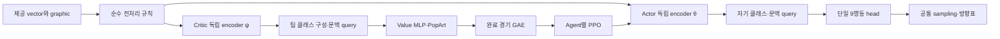

# v10 구현·비교 실험 계획 — 단일 Attention actor와 독립 지도 critic

작성일: 2026-10-11. 이 문서는 설계 기준이다. 기본 C0/C1 구현과 실행·관전 인터페이스는 [v10 안내](../README.md)에 정리했다. **실제 Unity 학습·평가·관전은 아직 실행하지 않았으며, 후속 계약 의존 확장은 기본 구현에서 비활성이다.**

배치는 [루트 README](../../../README.md)와 [프로젝트 디렉터리 안내](../../common/project_layout.md)를 따른다. 사용자가 제안한 구조를 기본안으로 채택하고, [v9 결과](../../common/history.md), 현재 코드, 제공 [제출 규격](../../common/blackout_last_4_pages.md)을 대조했다. 논문은 §16의 원문을 웹에서 열람했으며 로컬에 다운로드하지 않았다.

## 1. 결정 사항과 첫 구현 범위

**아군 5명이 파라미터를 공유하는 소형 stateless Attention actor와, 지도·개체·팀 정보를 읽는 독립 Attention critic을 MAPPO로 학습한다.** actor의 장면 인코더는 v9의 형태를 유지하고 출력만 단일 STOP+8방향 categorical head로 정리한다. critic은 학습 전용이며 제출물에 포함하지 않는다.

| 구분 | 기본 v10에서 고정할 사항 |
|---|---|
| actor 입력 | 제공 vector 96개, graphic 11×96×96 전체; 추가 ID·팀 집계·raw reward 입력 없음 |
| actor 크기 | width 64, latent 32개, heads 4, latent block 2개, FFN 128 |
| actor 출력 | 단일 9행동 분포; rollout·평가·제출에서 동일한 sampling과 방향표 |
| critic | 독립 scene encoder, 팀 query, value MLP, 출력 보존 PopArt |
| 학습 | agent별 PPO ratio, 공통 팀 advantage; actor/critic 별도 optimizer |
| 첫 구조 대조 | C0: 기존 vector critic / C1: 지도 Attention critic |
| 변경하지 않을 것 | 제공 게임·API·obs 생성/전처리·원본 reward·전송 경로 |
| 별도 대조 | 지도 차단 critic, 과거 raw reward ledger, GAE, potential, 상대 노출, BC |
| 계약이 필요한 확장 | 공식 self-ID → self query → 목표 상태 → 필요한 기억 → 역할 계층 |
| 실행 | 원본 렌더링을 유지한 창 없는 Unity, 분리된 백그라운드 supervisor |
| 제출 | `policy.py`와 `checkpoint.pt` 두 파일; actor만 export |

첫 기본값은 BC=0, auxiliary=0, history/PFSP off, 역할 head/GRU off다. actor·보상·상대·예산까지 한꺼번에 바꾼 결과를 지도 critic의 효과라고 부르지 않는다. 기존 v9 B 선택 모델의 가중치 이식은 변환 검증 및 별도 warm-start 연구에만 사용한다. 주 비교는 seed별 새 actor 초기화에서 출발한다.

### 1.1 추가 운영 요구사항과 완료 조건

아래 다섯 항목은 선택 기능이 아니라 v10 구현의 필수 범위다. 이 문서의 명령은 구현 후 제공할 인터페이스이며, 계획 작성만으로 실행 준비가 끝난 것은 아니다.

| 요구사항 | 구현 위치 | 완료 조건 |
|---|---|---|
| 현재 하드웨어에서 최대한 빠른 전체 실험 | §10 benchmark·자원 스케줄러 | 실제 CPU/MPS 전체 경로 측정으로 장치를 선택하고 본 비교·확인·평가를 모두 실행; 가속을 이유로 seed·경기·step 예산을 줄이지 않음 |
| 게임 창 없는 백그라운드 실험 | §11.1 supervisor·rendered launcher | 터미널에 즉시 제어권 반환, 터미널 종료 뒤 계속 실행, 학습·평가·live probe 모두 창 숨김 및 graphic 11채널 유효성 통과 |
| 이전 모델과의 실제 플레이 관전 | §11.2 viewer·모델 목록 | v10 대 이전 버전의 가중치를 명시적으로 로드하고 화면에 실제 경기 표시; 진영 교체마다 버전·checkpoint를 안내 |
| 공식 observation·제출 형식 | §3.4 및 §13 | 원본 입력·게임 유지, 두 파일을 제공 loader로 독립 로드, 입력/출력 규격 검사 통과 |
| 실험과 관전 각각 한 줄 실행 | §11.1–11.3 shell entrypoint | 별도 cd·환경 활성화·PYTHONPATH·수동 export 없이 절대 경로 명령 한 줄로 실행 |

## 2. 로컬 확인과 해결하려는 문제

### 2.1 확인한 근거

현재 로컬 HEAD는 `2cdb5769ccfe763348b7dc46aefad25b39fdb370`이다. 사용자가 인용한 `f89ec551b7e31680be4e82f9ad84f137be13ec41` 객체는 로컬에 없었고, 해당 GitHub history/policy 페이지도 웹 도구로 열리지 않았다. 따라서 두 커밋의 내용이 동일하다고 단정하지 않는다. 아래 사실은 현재 로컬 파일과 원시 집계에서 재확인한 내용이다. 구현 시 실제 시작 commit·dirty diff·파일 해시를 새 registration에 고정한다.

| 근거 | 확인한 내용 | v10 결정 |
|---|---|---|
| [history](../../common/history.md), [v9 최종 집계](../../../logs/v9/attention_original_v1/summary.json) | 선택 B_s22 58/240=24.17%, 미학습 기준선 60/240=25%; B/C dev 13.61%/13.06% | 미학습 기준선과 새 대조를 다시 측정; actor 용량 부족으로 단정하지 않음 |
| 같은 최종 집계 | 학습 모델 승리는 raider 58/60, 다른 세 상대 0/60; 미학습도 raider 60/60에 집중 | macro 승률 외 상대별·진영별·전략별 성능을 필수 보고 |
| [v9 actor](../../../code/v9/blackout_v9/policy.py) | 587 token→32 latent, query 6차원; A/B는 expert 0만 활성 | scene/query를 유지하며 expert 0을 단일 head로 정확히 변환 |
| [v9 critic](../../../code/v9/blackout_v9/value.py) | 팀 vector 평균→96–128–128–1 MLP, graphic 입력 없음 | 지도·개체 Attention critic을 독립적으로 도입 |
| [관측 결합](../../../code/v9/blackout_v9/trajectory.py) | 10개 개체·점수·시간 및 graphic의 팀 내 동일성을 검사 | vector 평균은 모든 개체 좌표를 한 좌표로 합치는 연산이 아님; 클래스 부분만 팀 구성비가 됨 |
| [v9 PPO](../../../code/v9/blackout_v9/ppo.py) | agent별 ratio, 분리 optimizer, minibatch마다 encoder 재계산; KL은 update 직전 측정 | 전체 update 후 KL·손실별 gradient·정책 변화를 추가 검사 |
| [v9 collector](../../../code/v9/blackout_v9/collector.py), [보상](../../../code/v9/blackout_v9/rewards.py) | 완료 경기만 반영, 원본 raw reward 누적의 최종 부호와 bounded shaping | 비정상 종료를 terminal 승패로 치환하지 않고 원본 경로 유지 |
| [v9 이력](../../common/history.md) | B_s22: 76경기·수집→PPO 14회, target step 약 2%, history 약 41% | batch의 경기 수·step·갱신 횟수·상대별 loss 기여를 함께 기록 |
| [관측 명세](../../../code/shared/blackout_rl/observation.py) | 자기 클래스는 있으나 호출 유닛의 self-ID는 없음 | 동일 관측의 유닛별 정밀 역할 배정을 이미 해결했다고 주장하지 않음 |
| [경로 초기화](../../../code/shared/project_paths.py) | `activate()`와 `package_paths()`가 현재 v1~v9만 열거 | v10 탐색 추가와 외부 cwd·새 interpreter 검사를 첫 구현 작업에 포함 |

v9 실행 시간은 약 108시간 25분, 실제 학습 12,515,327 step, 평가 4,016경기였다. 전체 시간을 학습 step으로만 나눠 Unity 처리량이나 v10 ETA로 사용하지 않는다. 기존 실험 기록은 읽기 전용 근거이며 수치·승패·해시를 다시 쓰지 않는다.

### 2.2 가설과 비목표

- H1: 지도 critic이 vector critic보다 가치 추정에 유용한 정보를 제공하고, 동일한 actor의 학습 성능을 개선한다.
- H2: 로컬 승패가 누적 raw reward에 의존하므로 현재 관측에 없는 과거 ledger가 critic의 상태 별칭 문제를 줄일 수 있다. 기본안에 섞지 않는다.
- H3: 긴 경기·낮은 갱신 빈도·상대별 step 불균형도 별도 병목이다. H1이 실패했다고 대형 actor가 필요하다고 바로 결론내리지 않는다.
- 첫 구현은 올킬·입구 봉쇄·약탈 능력을 보장하지 않는다. 그 행동이 실제 관측과 평가에서 나타났는지를 검증하는 기반을 만든다.

## 3. 입력·종료·제출 계약

### 3.1 원본 유지

`artifacts/builds/BlackOut.app`, 프로젝트 외부 `blackout`/`blackout-env` 저장소, 설치된 제공 API와 obs 전처리의 해시를 v9 원본 계약과 대조한다. Unity 타이머/렌더러 패치, 새 side-channel, hidden reset step, 내부 게임 상태 읽기, `-nographics`, transport overlay를 도입하지 않는다. 공개 env 인자만 사용한다.

모델 내부의 tokenization·lossless 압축·critic 전용 feature는 제공 obs를 읽어 계산한다. 원본 ndarray를 in-place 변경하지 않는다. 게임 화면의 숨은 UI 수량이나 추정한 self-ID를 제공 관측인 것처럼 사용하지 않는다.

### 3.2 승패 기준을 명시적으로 분리

제출 안내는 학습 보상과 대회 점수 집계를 구분하지만, 현재 설치된 `blackout_env/competition/match.py::run_match`는 팀별 누적 raw reward를 비교한다. 기본 연구 objective는 v9와 같은 `provided_runner_v1`이며 이를 게임 점수 승리와 동일시하지 않는다.

- actor 입력은 공식 두 tensor뿐이다. critic 기본 입력도 제공된 아군 관측에서만 만든다.
- 팀 raw reward ledger는 후속 critic 전용 연구 입력이다. 제공 반환 reward를 이용하는 학습 메타데이터이며, 현행 obs-only 제약과 양립하는 학습 정보인지 계약을 별도로 확인한다. 기본 C0/C1은 ledger를 사용하지 않는다.
- 공식 판정 기준이 확정되면 새 `objective_id`, config, registration, baseline으로 실험한다. 이전 학습 중간에 terminal label만 바꾸지 않는다.
- `format_ready`, `critic_prediction_improved`, `local_runner_improved`, `game_outcome_verified`, `strategy_coordination_certified`, `official_server_certified`를 각각 기록한다.

### 3.3 동일 관측과 자기 식별의 한계

같은 클래스·같은 관측이면 stateless shared actor의 행동 **분포**는 같다. 독립 sampling이 다른 행동을 낼 수 있지만, 특정 유닛의 위치·운반 상태에 맞는 역할 할당을 보장하지 않는다. entity slot embedding은 관측에 이미 있는 10개 슬롯의 순서를 나타낼 뿐 호출자의 self-ID가 아니다.

수집기에서 유닛 이름을 사용해 아군 5명을 모으거나 action을 라우팅하는 것은 허용 인터페이스 연결이다. 그 이름·배치 행을 actor query나 hidden-state key로 주입하는 것은 기본 계약에 포함하지 않는다. critic의 팀 클래스 구성비도 actor의 입력으로 역류시키지 않는다.

### 3.4 제출 안내의 observation을 끝까지 유지

기준 문서는 [blackout_last_4_pages.md](../../common/blackout_last_4_pages.md)다. 학습·평가·관전·export에 동일한 계약 검사를 적용한다.

- vector는 float32 96차원: 개체 10개×9(위치 2, 팀 부호 1, 보유 아이템 6) + 자기 클래스 3 + 점수·시간 3이다. 누락·재정의·추가 정보를 주입하지 않는다.
- graphic은 원본 환경에서 float32 `[96,96,11]`, 제공 loader를 거친 actor 입력에서 `[B,11,96,96]`이다. 채널 순서는 빈 공간·벽·아군 창고·적군 창고·아군 유닛·적군 유닛·배터리·BuffSpeed·DebuffSpeed·BuffSize·DebuffSize 그대로다. 창 숨김이나 처리량 최적화를 이유로 채널 제거·해상도 축소·렌더링 비활성화를 하지 않는다.
- 제출 `MyPolicy.forward(vector, graphic)`은 float32 `[B,2]`, 각 값 `[-1,1]`의 행동을 반환한다. 입력·출력의 batch 의미를 유지하고, 단일 9행동 표집 결과를 고정 방향표로 변환한다.
- 제출물은 `policy.py`와 `checkpoint.pt` 두 파일이며 `policy_state` 저장 형식을 사용한다. critic·과거 모델용 adapter·게임 접근·관전 UI는 제출 actor 밖에 둔다. 안내의 CUDA 로드 예시는 Mac에서 CUDA를 사용하라는 조건이 아니므로 로컬 검증은 CPU 및 사용 가능한 MPS로 수행한다.

## 4. 네트워크 설계



### 4.1 Actor: `MyPolicy(vector_size=96, n_channels=11)`

| 단계 | 연산 | shape / 세부 조건 |
|---|---|---|
| 입력 | float32 vector, graphic | `[B,96]`, `[B,11,96,96]` |
| 지도 펼치기 | v9와 동일한 reshape·permute 순서, 4×4 patch | `[B,576,176]`; 11채널·모든 픽셀 유지 |
| 지도 embedding | Linear 176→64, bias 있음 | `[B,576,64]` |
| 위치·유형 | 24×24 normalized xy→64, bias 없음; type embedding | v9 `patch_xy` 순서와 그대로 일치 |
| entity | 10×9→MLP 9→64→64, GELU | entity slot `[10,64]`와 type 추가 |
| context | vector `[93:96]`→Linear 3→64 | `[B,1,64]` |
| 장면 | map+entity+context, LayerNorm | `[B,587,64]` |
| cross attention | learned latent `[32,64]`, heads=4 | `latent + cross(latent,tokens)` |
| latent blocks | pre-LN self-attention×2, GELU FFN 64→128→64 | dropout=0, `[B,32,64]` |
| query | vector `[90:96]`→Linear 6→64 | class 3 + score/time 3 |
| readout | query+Attention(query,latent), LayerNorm | `[B,64]` |
| head | Linear 64→9, log_softmax | STOP + 8방향; `[B,9]` |
| forward | categorical sampling 후 방향표 조회 | float32 `[B,2]`, 각 값 `[-1,1]` |

`32 latent / width 64 / 4 heads / 2 blocks`는 v9와 비교하기 위한 프로젝트 초기값이다. Perceiver가 이 숫자를 BlackOut 최적값으로 제시한 것이 아니다[R2]. 176차원 patch의 재배열은 값 보존이지만 Linear 투영과 latent 처리는 학습된 압축이다. latent는 매 호출 초기화하는 공간 표현이며 시간 memory가 아니다.

공유 scene 최적화는 같은 호출의 graphic·개체·문맥이 실제로 동일한 경우에만 사용한다. B=0,1,3,5,10 및 여러 장면이 섞인 배치를 처리한다. `forward`가 B=5나 canonical row를 가정하지 않는다. 수집 전용 `team_log_probs([T,5,96],[T,11,96,96])`는 팀 내 동일성 검사를 통과한 자료에만 적용한다.

### 4.2 Critic

C0는 v9의 vector MLP를 유지한다. C1은 actor와 구조가 같은 별도 encoder와 readout을 갖고, value head만 `Linear(64,128)→Tanh→Linear(128,1)`로 둔다. encoder class 정의는 재사용할 수 있지만 **별도 instance·storage·optimizer**여야 한다. 완성된 actor latent를 detach해 critic 입력으로 재사용하지 않는다.

```text
입력 vectors: [T,5,96], shared_graphic: [T,11,96,96]
scene entities/context: vectors[:,0,:90], vectors[:,0,93:96]
team_class: mean(vectors[:,:,90:93], dim=1)                 # [T,3]
team_query_input: concat(team_class, vectors[:,0,93:96])  # [T,6]
critic encoder → query readout → 64→128→1 → PopArt 복원    # [T]
```

개체·문맥이 공통인지 먼저 검사한다. 클래스 구성은 수집된 각 아군의 class만 집계하며 상대 유닛의 미제공 class나 게임 내부 정보를 보충하지 않는다. graphic이 아군별로 달라지는 환경이면 첫 행을 무조건 고르는 압축 경로를 중단하고 새 입력 계약으로 설계한다.

critic 출력은 shaped return의 기대값이며 승률 sigmoid가 아니다. C0/C1 모두 같은 PopArt 초기 mean=0, scale=1과 같은 loss를 사용한다. 주 실험 초기 scalar output은 두 critic 모두 0으로 초기화해 초기 value 차이를 줄인다. 이때 첫 backward에서 출력층 이전의 gradient가 0일 수 있으므로 critic encoder 연결 검사는 출력층이 갱신된 뒤 여러 minibatch에 걸쳐 수행한다. 첫 minibatch의 0 gradient만으로 연결 오류라고 판정하지 않는다. 이후 critic만 optimizer로 갱신해도 actor logits가 변하지 않아야 한다. 분리 actor–critic 및 중앙화 value의 원칙은 MAPPO를 참고하되, BlackOut에서의 성능 향상은 H1로 검증한다[R1].

### 4.3 파라미터 수와 비용

아래 actor 수는 현재 v9를 메모리에서 로드하고 expert/gate/auxiliary를 제거해 Linear(64,9)를 붙여 재계산했다. 저장·학습은 하지 않았다. critic 수는 같은 encoder/readout을 복제하는 명시된 설계에 대한 산술값이다. 구현 시 `sum(p.numel())`과 모듈별 표로 다시 검증한다. buffer·optimizer state는 파라미터 수에서 제외한다.

| 모델 | actor | critic | 학습 파라미터 합계 |
|---|---:|---:|---:|
| v9 기존 모듈 | 123,765 | 29,057 | 152,822 |
| v10 C0 | 120,905 | 29,057 | 149,962 |
| v10 C1 | 120,905 | 128,769 | 249,674 |
| v10 ledger 후보 | 120,905 | 128,897 | 249,802 |

actor head는 585개, 공유할 수 없는 actor의 encoder/query 부분은 120,320개다. 지도 critic은 `120,320 + 8,320 + 129 = 128,769`개다. ledger query 6→8 확장은 128개를 더한다.

제출 actor는 v9보다 2,860개, 약 2.31% 작으며 FP32 학습 가중치 자체는 483,620 bytes다. 실제 checkpoint는 buffer·직렬화 overhead를 포함한다. C1의 학습 파라미터 합계는 v9보다 약 63.4% 많다. 따라서 actor 축소를 전체 학습 가속으로 해석하지 않는다. activation 메모리·지도 처리량·critic batch 지연을 별도로 측정한다.

### 4.4 v9→단일 head 변환과 초기화

1. v9 A/B 또는 expert 0만 활성인 checkpoint만 변환한다. 실제 mask·decoder·source hash를 검사한다. C mixture는 단일 Linear head로 정확히 변환할 수 없으므로 거부한다.
2. scene/query/readout 파라미터와 위치·방향 buffer를 복사한다. `action_head.weight=experts.weight[:9]`, bias도 첫 9개를 복사한다. gate·나머지 expert·auxiliary는 제거한다.
3. 새로운 optimizer는 새로 만든다. 바뀐 모듈의 Adam state를 순서 기준으로 억지 이식하지 않는다. 과거 B_s22의 가중치를 baseline scratch 초기화로 사용하지 않는다.
4. `log_softmax` 결과를 동일 입력에서 v9와 비교한다. CPU atol=2e-6/rtol=1e-5를 출발 gate로 쓰고 MPS 허용차는 offline parity 측정 후 config에 고정한다. action 표집은 같은 RNG와 호출 순서에서 별도 검증한다.
5. seed별 actor 초기 state를 한 번 만들고 C0/C1/C1-blind에 그대로 복사한다. critic 생성이 actor RNG를 소비하지 않도록 RNG stream을 분리한다. 각 actor 초기 해시는 같아야 하며 서로 storage를 공유해서는 안 된다.

## 5. MAPPO·PopArt·긴 경기 보상

### 5.1 PPO 데이터와 gradient

기본 shape는 actor logs `[T,5,9]`, sampled action/log-prob `[T,5]`, value·return·advantage `[T]`다. 각 agent ratio는 `exp(logπ_new(a_ti|o_ti)-logπ_old(a_ti|o_ti))`이며 팀 advantage를 broadcast한다. 다섯 확률을 곱한 joint ratio로 변경하지 않는다. advantage·old logs·GAE target에는 gradient가 없어야 한다.

actor loss는 clipped PPO minus entropy다. 팀 advantage는 해당 train wave에서만 정규화하고 표준편차 하한 1e-8을 둔다. 각 timestep·agent의 loss를 평균하며 누락 agent를 조용히 0으로 채우지 않는다. 기본 BC·auxiliary coefficient는 0이다. critic은 PopArt로 정규화한 target에 Huber loss를 적용한다. value clipping은 v9 기본에 없으므로 C0/C1 첫 비교에 새로 넣지 않는다. encoder는 매 PPO minibatch에서 raw obs로 다시 계산하며 optimizer step을 넘는 latent cache는 금지한다.

| 항목 | 첫 구조 비교 기본값 |
|---|---|
| gamma / lambda | 1.0 / 0.9975 |
| actor / critic LR | 1e-4 / 3e-4, Adam |
| clip / entropy / target KL | .15 / .01 / .02 |
| PPO epoch / scene minibatch | 2 / 128 (device probe 후 같게 고정) |
| gradient norm | actor·critic 각각 .5 |
| value / BC / aux | Huber+PopArt / 0 / 0 |
| decoder | 모든 경로 categorical sampling |

각 minibatch 전 KL과 함께 실제 actor step **후**의 KL을 고정된 on-policy audit subset에서 다시 측정한다. 전체 wave 끝에는 old 분포 대비 categorical KL과 sampled approximate KL을 함께 남긴다. pre-step .02 초과 시 추가 actor update를 중지한다. post-step .02 초과는 다음 update 중지 및 기록, 비유한 값이나 사전 고정 hard bound .04 초과는 해당 minibatch 직전 actor·optimizer state로 원복하고 run을 진단 상태로 중지한다. 자동 LR 축소·반복 재시도로 좋은 결과만 남기지 않는다. 이 임계값은 프로젝트 초기 운영값이며 PPO의 이론적 보장이 아니다[R4].

### 5.2 PopArt

정규화 `z=(G-μ)/σ`, 복원 value `V=σ f+μ`를 구분한다. 통계를 바꿀 때 마지막 Linear의 weight·bias를 변환해 기존 비정규화 출력을 보존한다[R3]. v9에서 사용하는 출력층 Adam 1차·2차 moment의 scale 변환도 이어가되, 이것을 임의 재파라미터화에서 optimizer 궤적 전체가 동일하다는 주장으로 확대하지 않는다.

`beta=.99`, variance floor `1e-4`를 시작값으로 고정한다. 통계 변경 전 old value를 원래 return scale로 저장한다. 새 통계로 예전 normalized value를 해석하지 않는다. 통계는 train 자료에서만 갱신하며 eval·invalid episode로 갱신하지 않는다.

### 5.3 종료·보상

완료 경기의 기본 reward는 마지막 transition의 `y=sign(raw_own_total-raw_opp_total)`이고 나머지는 0이다. 기본 potential은 현재 v9와 동일하게 고정한다.

```text
Φ(o) = 0.25 × clip(0.7 × mean(own_score - opp_score), -1, 1)
r'_t = r_base_t + gamma × Φ(o_{t+1}) - Φ(o_t)
Φ(terminal) = 0
gamma=1이면 sum(r'_t) = y - Φ(o_0), 절댓값 ≤ 1.25
```

이는 완료된 궤적에서 직접 검사할 수 있는 항등식이다. POMDP·상대 정책 변경·비정상 종료로 걸러진 표본까지 포함하여 최적 정책 보존이 자동 증명됐다고 부르지 않는다. 특히 원 논문의 undiscounted 정식화는 proper termination 가정을 둔다[R6]. 무한 반복 경기에서 이미 모인 raw reward를 학습 return으로 사용하지 않는다.

- 자연 종료와 watchdog은 다르다. 전원 종료·유한 reward·관측 형식·시간 역행·종료 중복을 검사한다.
- episode마다 원본 환경을 새로 만든다. 게임 타이머를 고치거나 같은 프로세스의 반복 reset으로 처리량을 늘리지 않는다.
- `max_episode_steps=22,000`, wall=1,800초, heartbeat stall=120초, stop grace=20초로 시작한다. nonterminal step cap·transport error·예기치 않은 truncation은 invalid다.
- invalid·부분·중단 episode는 critic fit, PopArt, PPO, 상대 승률 갱신에서 제외한다. 대신 attempts/steps/reason을 모두 기록한다.
- invalid 비율 1% 초과 또는 3회 연속 invalid면 run을 중단한다. 평가에서는 invalid를 분모에서 조용히 빼지 않고 coverage 미완료로 처리한다. 선택적 종료 편향이 의심되면 성능 판정을 보류한다.

### 5.4 긴 GAE 전달과 후속 shaping

GAE는 자연 종료 시 `V_T=0`으로 한 경기 안에서 역산한다. lambda=.9975의 직접 terminal 계수는 1,000 step 전 약 .0818, 5,000 step 전 약 3.67e-6다. 이는 value를 통한 전달까지 없다는 뜻은 아니다[R5].

후속 단일 요인 비교 후보는 lambda .999, .9995, 1.0이다. 각각 유효 감쇠 길이·advantage 분산·gradient norm·상대별 성능을 보고, 초기 entropy만 보고 lambda를 고르지 않는다. gamma는 기본 비교에서 고정한다. gamma 변경은 경기 길이에 대한 목적 변화까지 가져오므로 별도 objective 실험이다.

추가 potential은 소유·운반 여부, 접근 가능한 목표까지 거리, 전달 진행처럼 **현재 제공 관측으로 결정할 수 있는 팀 지표**로만 정의한다. 예: `Φ=.25*clip(w_s score_margin + w_c carrying_progress + w_d delivery_proximity,-1,1)`, 가중치·좌표·거리 정규화·표적 소실 처리·mask를 별도 config에 고정한다. 누적 pickup/kill 건수 자체를 step마다 보너스로 지급하지 않는다. 왕복·창고 대기·반복 탈취·유닛 소실·목표 소실에서 telescoping과 bound를 검사하고 C0/C1 본 비교가 끝나기 전 기본 보상을 바꾸지 않는다.

## 6. 수집·가치 계산·실험 데이터

### 6.1 완료 경기와 학습 버전

v9의 staging→natural terminal 검증→commit→PPO 원칙을 유지한다. rollout 청크 길이가 episode 수명을 결정하지 않는다. 정책 버전이 다른 transition을 하나의 on-policy wave로 섞지 않는다. policy/critic/PopArt snapshot 해시, episode ID, attempt ID, opponent 해시, side, requested seed, action RNG, initial observation hash를 저장한다.

원본 게임에 seed를 요청했다는 사실과 실제 서로 다른 맵을 얻었다는 사실을 분리한다. 반복 initial hash를 숨기지 않는다. 현재 맵 구조·초기 상태에 대한 조건부 결과를 새로운 맵 일반화 결과라고 부르지 않는다.

### 6.2 지도 critic 가속: 종료 후 일괄 value 계산

critic은 action 선택에 사용되지 않는다. 기본 구현은 worker가 매 step 지도 critic을 실행하는 대신, **동결된 수집 시점 critic snapshot**으로 완료 episode의 저장 관측을 learner 쪽에서 묶어 평가한다.

1. wave 시작 시 actor·critic·PopArt를 함께 동결하고 `behavior_id`로 저장한다.
2. worker는 obs, action, exact old log-prob, pre-action potential, 원본 판정용 누적값과 진단을 수집한다. actor만 추론한다.
3. 자연 종료된 episode를 `validated`로 잠근다. incomplete episode는 여기서 탈락한다.
4. 해당 wave의 동결 critic·동결 PopArt로 `[T,5,96]`와 `[T,11,96,96]`를 microbatch 평가해 old value를 얻는다. 최신 learner critic을 대신 쓰지 않는다.
5. GAE·return을 계산하고 snapshot 해시와 함께 `committed`로 표시한다. 모든 대상 episode의 target이 준비된 뒤만 optimizer를 갱신한다.

이 방법은 기본 stateless critic·dropout=0에서 step별 value 계산과 같은 함수를 평가한다. CPU 기준 경로와 batch 경로의 values/GAE/return 오차를 검사한다. mixed precision이나 recurrent critic을 도입할 때는 별도 동치 검증이 필요하다. C0/C1 둘 다 같은 target 생성 경로를 사용해 실행 방식 차이를 구조 효과와 섞지 않는다.

### 6.3 기록과 크래시 복구

- vectors float32 `[T,5,96]`, shared graphic, action int64 `[T,5]`, old logs float32 `[T,5]`, potentials float64, outcome, metadata를 저장한다. value/advantage/return은 target 생성 단계에서 추가한다.
- 정확한 one-hot graphic만 uint8 class map으로 lossless 저장한다. float/nonbinary 관측은 원래 float32로 보존한다. argmax 근사나 채널 삭제를 하지 않는다.
- actor의 batch 행 순서와 collection routing 순서를 분리한다. 같은 경기를 재개하는 것으로 위장하지 않는다.
- optimizer 이전 snapshot, task RNG 소비, completed episode ledger, source/config hash와 로그 offset을 원자적으로 기록한다. 중단된 wave는 재사용 조건을 명시하거나 통째로 제외해 중복 PPO를 막는다.
- 학습 중 사용한 상대 checkpoint와 제출 후보는 불변 보관한다. 큰 staging은 commit/update 성공 후 정리하되 invalid 원인·작은 trace·checksum을 남긴다.

## 7. 상대 구성·전략 검증·조건부 teacher

### 7.1 첫 비교의 상대 일정

C0/C1 기본은 **v9 A의 고정 상대 혼합**을 사용한다. history/PFSP가 비활성일 때 v9 구현의 실제 비율은 noop .10, random .10, collector/rush/raider/defender 각각 .15, target .20이다([league 코드](../../../code/v9/blackout_v9/league.py)). seed별 opponent family·side·action RNG task 목록을 먼저 생성해 두 arm에 동일한 순서로 적용한다. 환경 난수와 전개까지 동일하다는 뜻은 아니다.

승패에 따라 상대를 교체하거나 history pool을 갱신하지 않는다. 각 update에 상대별 episode 수, 유효 env step, 버려진 step, return, advantage 통계, PPO loss/gradient 기여를 보고한다. step 비중이 작은 강한 상대를 발견해도 본 비교 중 비율을 임의 변경하지 않는다.

후속 노출 균형 실험은 별도 arm으로 한다. 완료 경기의 길이 이동평균으로 부족한 family를 다음 wave에서 더 배정하고, 배정 확률·상한·fallback을 기록한다. 현재 wave 안에서는 frozen actor를 유지하며 다른 behavior의 오래된 transition을 가져오지 않는다. 빠른 패배 경기만 반복돼 wall time이 폭증하면 사전 attempt cap에 따라 중단한다. sampling 변경과 loss 재가중은 동시에 도입하지 않는다.

### 7.2 전략 지표

| 전략 | 관측 가능한 진단 | 과장하지 않을 범위 |
|---|---|---|
| 수집·운반·배달 | 보유 변화, 자기 팀 위치/창고 근접, 점수 변화, 이동률 | 관측 proxy와 확정 이벤트를 구분; 배터리 수량을 존재 채널에서 복원했다고 주장하지 않음 |
| 공격·올킬 | 상대 점유 변화·respawn proxy·승리 경로, rush 상대별 결과 | 한 프레임 유닛 소실만으로 kill/all-kill 확정 금지 |
| 입구 봉쇄·수비 | 공개 맵 통로 주변 체류·상대 통과/우회·우리 점수 방어 | 단순 정지나 stuck을 방어 전술로 판정하지 않음 |
| 배터리 탈취 | 적 창고 접근, 보유/점수 변화의 시간 일치 | 이동·픽셀 차이만으로 탈취 수량 확정 금지 |

상태/시나리오를 만들기 위해 Unity를 수정하지 않는다. 원본 환경과 명시된 상대 정책으로 사례를 얻고, 사건 식별이 불가능하면 `unverified`로 표시한다. sampling seed와 episode 근거를 보존한다. critic loss 감소, 높은 이동률, expert 이름만으로 전략 습득을 선언하지 않는다.

### 7.3 Teacher·BC·DAgger

기본 비교는 teacher를 사용하지 않는다. 후속 teacher는 student와 **같은 시점·같은 입력으로 재현 가능한 정답**을 내야 한다. 기존 planner는 ID와 phase/target/blocked 상태를 갖기 때문에 현재 stateless actor에 무조건 증류할 수 없다. 동일 student 입력에 대한 teacher label 충돌률·STOP 편중·클래스별 entropy를 먼저 측정한다.

공식 ID가 없을 때는 장면 수준 접근 가능성 같은 보조 target만 후보로 삼거나, 동일 입력으로 정의되는 reactive teacher를 쓴다. ID만 허용되면 self query와 reactive teacher를 먼저 비교한다. state까지 허용되어야 기억을 쓰는 planner trajectory 증류를 검토한다.

BC replay는 지도학습 자료이며 PPO on-policy batch로 위장하지 않는다. DAgger는 learner 방문 상태에서 label을 추가하는 별도 수집 절차로 구현한다[R8]. BC 초기화와 demonstration gradient의 원리는 DAPG를 참고하되, 원 논문의 NPG와 v10의 PPO 결합을 구분한다[R9]. PPO+BC+aux 전체 update 뒤 KL을 검사하고, 별도 teacher optimizer가 actor를 몰래 추가 갱신하는 경로를 만들지 않는다. 후속 alpha/eta·감쇠·BC step 예산·정답 생성 비용은 새 config로 등록한다.

## 8. 비교 실험과 고정 예산

### 8.1 실험 식별자

v10의 C0/C1은 critic 대조 ID이며 v8 C1 정책 이름과 무관하다. `architecture_id`, `critic_mode`, `objective_id`, `decoder`, `input_contract_id`, `study_id`를 분리한다.

| arm / 순서 | 변경 | 질문 | 기본 자동 실행 여부 |
|---|---|---|---|
| C0 | 단일 head actor + v9 vector critic | 시작 분포·학습·제출 기준선 | 예 |
| C1 | 같은 actor + 독립 지도 critic | 제안한 전체 critic 교체의 효과 | 예 |
| C1-blind | C1과 같은 파라미터·연산, critic에만 고정 zero map | 지도 정보와 용량/구조 증가의 효과 분리 | C1 개선 시 후속 필수; 기본 본실험과 별도 예산 |
| C2 | C1 + pre-action raw reward ledger 2개 | 과거 판정 정보의 가치 | 입력 계약 확인 후 별도 실행 |
| L/P/E | lambda / potential / 상대 step 노출 각각 한 요인 | 긴 경기·신호·노출 병목 | 자동 연결하지 않음 |
| T | 입력 호환 BC/DAgger | 연속 행동 학습 | label gate 후 |
| I/M/R | self query / 목표·memory / 역할 계층 | 개별 제어·지속 목표 | 공식 계약 gate 후 |

C1-blind에서는 actor와 원본 obs를 그대로 두고 critic의 graphic 입력만 0으로 바꾼다. 두 C1 계열을 같은 critic 초기 state에서 학습한다. 추론 시 shuffle/occlusion만으로 causal 성능을 확정하지 않는다. C1 대 C0는 정보와 구조가 함께 달라지는 비교이므로, blind 재학습 대조 전에는 “지도 정보를 추가했기 때문”이라는 인과 표현을 보류한다.

### 8.2 기본 실행 단계

아래 예산·gate는 논문에서 가져온 최적값이 아니라 현재 하드웨어와 v9 비용을 고려한 등록 초안이다. 최초 `--prepare`에서 고정하며 실행 도중 유리한 방향으로 바꾸지 않는다.

| 단계 | 기본 예산 / 실행 | 통과 조건 |
|---|---|---|
| P0 offline | 원본/shape/hash/단일-head 변환, synthetic PPO·PopArt·export, CPU/MPS probe | 학습·Unity 없이 기술 gate 통과 |
| P1 lifecycle | 기본 worker=4, 원본 환경 20경기 | 정상 종료·원본 obs·창 숨김·worker cleanup 검증 |
| P2 value 진단 | frozen 초기 actor로 별도 16경기; 12 fit/4 holdout, critic만 임시 학습 | 동일 episode split으로 C0/C1/blind value/MC 오차 비교; 모든 진단 가중치는 본학습에 재사용하지 않음 |
| P3 기능 pilot | C0/C1 각각 seed 11, 목표 131,072 step | encoder gradient·bound·GAE·전체 actor KL·collector 계약 통과; 승률이 낮다고 임의 실패 run 삭제 금지 |
| P4 본 비교 | C0/C1 × seeds 11/22/33, 각각 새 초기화, 1,048,576 유효 env step | 같은 정책 초기 해시·예산·상대 일정; 중간 model 선택 없음 |
| P5 추가 확인 | C0/C1 × seeds 44/55, 각 1,048,576 step | 본 비교 기술 gate 통과 후 두 arm 모두 시행; 성능이 불리한 arm도 생략하지 않음 |
| P6 동결 test·export | P4 dev로 고정한 C1 후보, 그 seed의 C0 최종 모델·초기 actor | 새로운 action RNG block으로 평가; test 결과로 후보 재선택 금지 |

기본 학습 목표 합계는 `2×131,072 + 6×1,048,576 + 4×1,048,576 = 10,747,904 env step`이다. P1/P2/평가·오류 시도는 별도다. 마지막 wave가 끝나야 갱신하므로 run당 초과 상한은 worker 수×22,000 step이다. 목표·실제·attempted·valid·discarded step을 각각 보고한다. 예산 초과를 지우거나 부분 경기를 완료로 자르지 않는다.

P2에 필요한 full observation/return 자료가 과거 staging 정리로 없으면 요약 JSON이나 마지막 250-step trace로 전체 궤적을 꾸며 만들지 않는다. 위 별도 diagnostic episode를 수집한다. episode 단위 train/holdout으로 나누며 가까운 frame을 양쪽으로 흩뿌리지 않는다. P2의 주 예측 진단은 동일 초기 actor의 Monte Carlo shaped return에 대한 비정규화 MSE/MAE·explained variance다. return variance가 0이면 EV는 null로 기록한다. self-bootstrapped target을 같은 학습 batch에서 더 잘 맞춘 것만을 critic 개선으로 보고하지 않는다. 실제 학습 중에는 update 전 held-out probe와 상대별 오차·GAE 분산을 별도 기록한다. P2 예측 오차가 개선되지 않아도 기술적으로 유효한 H1 본 비교를 자동 은폐하지 않는다. 다만 비용·설계 변경이 필요하면 새 등록으로 중단 이유를 남긴다.

### 8.3 평가 예산·선택·해석

평가 family는 collector/rush/raider/target 4개, 양 진영 균형이다. 경기의 승·무·패를 따로 저장한다. primary win rate는 `wins / valid_games`, draw는 별도; score rate `(wins+.5*draws)/N`는 보조 지표다. invalid가 있으면 primary 비교는 미완료이며, `wins / all_attempts`도 보수적 보조 지표로 보고한다.

- P4/P5 초기 actor는 seed별 한 번만 10 repetitions×2 sides×4 families=80경기 평가한다. C0/C1 시작 actor가 동일하므로 baseline을 중복 실행하지 않는다. seeds 11/22/33의 240경기와 44/55의 160경기를 합쳐 총 400경기.
- P4 최종 dev는 6개 run 각각 30×2×4=240경기: 총 1,440경기.
- P5는 4개 run 각각 240경기: 총 960경기. 확인 결과로 P4 제출 후보를 바꾸지 않는다.
- P6는 동결 후보/C0/초기 actor 각각 240경기: 총 720경기.
- 위 평가 합계는 **3,520경기**다. pilot 진단은 arm당 최대 4×2×4=32경기, 총 64경기로 별도 계상한다. v9·v8·추가 전략 상대를 새로 평가하면 해당 비용을 별도 추가한다.

P4의 C1 최종 dev가 가장 높은 seed를 선택하되 동률은 seed 오름차순으로 고정한다. 최고 중간 checkpoint를 골라 추가 이득을 만들지 않는다. C1이 실패해도 선택 규칙·전체 결과를 보존하고 `research_candidate`로만 export할 수 있다. C0/v9로 제출 후보를 바꾸는 의사결정은 test를 다시 사용하지 않는 별도 등록이 필요하다.

주 비교는 training seed를 단위로 한 C1−C0 macro win-rate 차이, 학습된 C1−동일 초기 actor 차이다. family/side strata를 유지하고 episode outcome의 5개 action이나 21,000개 frame을 독립 표본으로 취급하지 않는다. seed block은 같은 초기화를 공유하므로 비교하되, 환경 적용 seed가 확인되지 않은 경기끼리 동일 map의 paired trial이라고 주장하지 않는다. 경기 수준 bootstrap은 독립 action RNG block 단위이며, run-level bootstrap과 구분한다. 3/5 training seeds의 구간은 탐색적 불확실성으로 표시하고 모든 seed 점수를 공개한다.

**운영 성공 gate 초안:** 5개 seed에서 C1−C0 평균 최소 +5 percentage points, 개선 방향이 최소 4/5 seeds에서 같음, 학습 전 기준선도 개선, raider 외 적어도 한 family의 개선 및 관측 가능한 수행 근거 확보. 동시에 run/block 불확실성 구간을 보고하며 95% 구간이 0을 포함하면 “일관된 성능 향상 확정”으로 표시하지 않는다. 표본 부족이면 예산이 정해진 별도 confirmation을 등록한다. test 결과에 맞춘 seed 추가나 반복 test를 하지 않는다. `game_outcome_verified`와 공식 대회 성능은 이 로컬 gate로 승격하지 않는다.

C1-blind는 개선 주장에 필요한 다음 단계로, 동일 seeds 11/22/33과 1,048,576 step씩 **3,145,728 step**, 최종 dev 720경기를 추가한다. 계획된 후속 예산을 기본 10,747,904 step에 숨겨 포함시키지 않는다. ledger·lambda·potential·teacher 실험도 별도 study다.

## 9. Critic ledger 후속안과 시간 정보 누설 방지

C2가 허용될 경우 query는 6→8차원으로 바뀐다. 추가 두 값은 행동 직전까지의 팀 raw reward 합이다.

```text
ledger_t = [sum(raw_own[k], k<t), sum(raw_opp[k], k<t)]
query_t = concat(team_class[3], score_time[3], normalized(ledger_t)[2])
```

초기 ledger는 0이며 `obs_t`를 저장할 때 먼저 snapshot을 기록한 뒤 `env.step(a_t)`의 reward를 누적한다. `ledger_{t+1}`나 최종 승패를 `V_t` 입력으로 넣지 않는다. 자연 종료 뒤 얻은 outcome은 target이다. 현재 observation에 과거 reward가 모두 포함되지 않을 수 있으므로 이는 critic의 부분 관측을 줄이는 후보이지 완전 Markov state 증명이 아니다.

ledger 원본은 float64로 보존하고 입력은 `sign(x)*log1p(abs(x))` 같은 고정 변환을 등록한다. episode 최종 합으로 현재 값을 나누거나 eval/test로 normalization을 맞추지 않는다. future reward를 바꿔도 이전 ledger/value 입력이 바뀌지 않는 검사를 만든다. 원본 obs-only 제약이 reward history의 critic 입력을 허용하지 않으면 C2는 비활성 상태로 남긴다.

## 10. M4 Pro 가속·메모리·예상 시간

### 10.1 확인한 장비와 출발 설정

2026-10-11 로컬 `system_profiler`에서 Mac mini `Mac16,11`, Apple M4 Pro, CPU 12 cores(8P+4E), memory 48 GB를 확인했다. 설치 torch는 2.13.0이다. 계획 작성 시 제한된 세션에서는 `torch.backends.mps.is_available()`이 false였지만, 구현 검증에서는 제한 밖의 합성 probe로 MPS 가용성과 CPU 수치 동치를 확인했다. 실제 시작 환경에서도 offline probe로 재판정한다.

| 영역 | 초기 설정 | 채택/변경 조건 |
|---|---|---|
| actor 수집 | CPU, worker당 BLAS/torch 1 thread | B=5 p50/p95, env 전체 지연 비교; 2 threads는 oversubscription 검사 후 |
| learner | CPU/MPS auto, 단일 learner | actor+critic forward/backward+Adam+전송 전체 측정과 gradient parity 통과 |
| worker | 기본 4, cap 8 | 선택적 2/4/6/8 calibration 후 본 비교의 양 arm에 동일 고정 |
| PPO minibatch | scene 128; 후보 64/128/256 | C0/C1 공통으로 가능한 크기; 다른 minibatch 변경은 별도 기록 |
| critic value batch | GPU memory 안에서 128/256/512 후보 | microbatch 동치·메모리·전송을 포함한 처리량 기준 |
| memory | process tree RSS·system available·pressure 측정, soft 32 GiB | macOS·통합 GPU 여유를 남김; pressure가 우선, swap thrashing 금지 |
| disk | 시작 여유 25 GiB, stop reserve 15 GiB를 최소값으로 유지 | 실제 staging 최악치+checkpoint+로그가 더 크면 필요한 reserve를 상향 |

단일 FP32 scene graphic은 405,504 bytes다. 22,000 step이면 약 8.31 GiB/episode이며 nonbinary fallback이 많으면 8 workers만으로 48 GB를 넘는다. 정확한 uint8 map은 9,216 bytes/step, 약 .189 GiB/22,000 step이다. 따라서 “대부분 one-hot일 것”이라는 가정만으로 시작하지 않고 fallback 비율·staging 파일 수·실제 disk 여유로 동적 상한을 계산한다. 제한 초과 시 관측을 손실 압축하지 않고 안전 중단한다.

### 10.2 우선순위가 높은 가속

1. 동일 팀의 verified shared scene을 actor당 한 번만 인코딩하고 5 query를 병렬 처리한다. critic과는 학습된 latent를 공유하지 않는다.
2. §6.2의 종료 후 critic 일괄 계산으로 worker의 매-step 두 번째 Attention forward를 없앤다. CPU/MPS 전송과 chunk decode를 포함해 측정한다.
3. uint8/memmap 저장과 contiguous batch decode를 유지한다. zero-copy 가능한 numpy→torch 연결을 사용하고, device 전송은 minibatch 단위로 묶는다. materialized FP32 전체 episode를 GPU에 한꺼번에 올리지 않는다.
4. actor/critic optimizer step 후에만 state를 CPU로 snapshot한다. parameter별 `.item()`/`.cpu()`를 반복하는 telemetry 동기화를 묶고 상세 로그는 update·heartbeat 단위로 제한한다.
5. 여러 run을 각각 최대 workers로 동시에 실행하지 않는다. C0/C1 runs를 seed 내 교대 순서로 직렬 운영하고 전체 Unity worker cap을 공유한다. 평가도 동일 전역 자원 pool을 사용한다.
6. optimizer를 갱신하는 동안 다음 다른 버전의 rollout을 동시에 수집하지 않는 동기식 기본값을 유지한다. 환경 시작과 파일 읽기 같은 독립 작업의 overlap만 동치 범위에서 허용한다.
7. 평가에서는 critic을 로드하지 않는다. 초기 actor가 같은 비교 arm의 평가를 재사용하고, 전체 live 중간 평가를 기본에서 생략한다. 평가 관측/성능자료를 actor 학습 자료로 재사용하지 않는다.
8. 가장 긴 경기 하나에 나머지 worker가 묶이는 barrier idle을 기록한다. fixed behavior wave 내 작업 배정 최적화는 가능하지만, 오래된 actor 경기를 새 PPO batch로 섞어 처리량을 부풀리지 않는다.

`torch.compile`, mixed precision, asynchronous/off-policy correction, persistent Unity reuse는 기본에서 보류한다. PyTorch SDPA는 현재 v9처럼 사용하며 CUDA 전용 FlashAttention이 MPS에서도 적용된다고 가정하지 않는다. fp16 등은 별도 logits/gradient/PopArt/export parity와 실제 end-to-end 이득을 입증한 뒤에만 같은 비교 조건으로 도입한다.

선택적 live worker calibration은 frozen actor·고정 opponent task 16개를 worker 2/4/6/8로 각각 처리해 최대 64경기다. 이 비용은 P1 및 본학습과 별도 표기한다. 요청 seed가 실제 동일 환경을 보장하지 않으면 통제된 배속 인과 실험이 아니라 운영상의 처리량 측정으로 표시한다. 본 실험 중 안전상 worker를 낮춘 경우 양 arm의 설정 변경·시간·wave 크기를 기록한다.

### 10.3 ETA와 로그

`ETA = 남은 유효 학습 step / 최근 end-to-end 학습 step/s + 남은 평가 경기×상대별 최근 경기 시간 / 평가 병렬도 + 아직 필요한 gate 비용`으로 계산한다. 학습 시간에는 env 시작·수집·target 계산·PPO·checkpoint 저장을 포함한다. target/rush처럼 짧은 패배와 장시간 상대의 평균을 섞은 단일 경기 시간만 쓰지 않는다.

학습/critic value/actor backward/critic backward/env reset/env step/storage/평가의 p50/p95, warmup·컴파일 비용, process tree memory, disk·fallback 비율을 별도 기록한다. 통합 메모리의 RSS 합산은 공유 페이지를 중복 셀 수 있으므로 system pressure와 함께 판단한다. 고정된 며칠·몇 배 가속을 계획 단계에서 약속하지 않는다.

### 10.4 자동 장치 선택과 최적화 검증의 구현 계약

`--device auto`를 기본으로 하되 `--device cpu|mps`로 learner 장치를 지정할 수 있게 한다. collector와 관전 actor는 별도 `--actor-device auto|cpu|mps`를 제공하며, auto의 출발값은 작은 batch에 적합한 CPU다. MPS 가용성만 확인하고 곧바로 가장 빠른 장치라고 결정하지 않는다.

1. 첫 실행은 실제 장비·macOS·Python·torch·MPS 가용성·스레드 설정을 기록하고, 같은 초기 가중치와 관측으로 CPU/MPS warmup 및 반복 측정을 수행한다. actor batch=5, C0/C1 양쪽의 target 계산·forward/backward·optimizer·메모리 전송까지 포함한다. MPS 시간은 측정 경계에서 동기화하여 비동기 enqueue 시간만 보고하지 않는다.
2. logits·가치·gradient·optimizer 이후 파라미터의 유한성/수치 허용 오차와 PopArt를 먼저 검사하고, 통과한 후보 중 전체 study의 예상 소요 시간이 짧은 공통 learner 장치를 선택한다. C0/C1의 주 비교에는 같은 장치·minibatch·worker 설정을 적용한다. CPU가 더 빠르면 CPU를 채택한다.
3. auto에서 MPS 미지원 연산·메모리 부족·검증 실패가 있으면 CPU 선택 사유를 기록한다. 실행 중에는 완료 wave checkpoint 경계에서 optimizer state까지 일관되게 옮겨 재개하고, 부분 update를 중복 적용하지 않는다. 명시적 `--device mps` 요청이 불가능하면 이유와 CPU 재실행 명령을 알리고 중단한다. 연산별 조용한 CPU fallback으로 MPS 성능을 잘못 보고하지 않는다.
4. profile에서 확인한 병목을 우선 개선한다. scene 중복 계산 제거, 일괄 critic 계산, contiguous/memmap I/O, inference mode, thread cap, CPU snapshot/로그 동기화 절감을 각각 변경 전후에 측정한다. full rollout·update·평가 시간과 메모리를 보고하여 작은 kernel만 빨라진 결과를 전체 가속으로 주장하지 않는다.
5. probe 결과는 하드웨어·소프트웨어·소스·config 해시와 함께 `logs/v10/<study>/runtime_profile.json`에 저장한다. 같은 조합이면 재사용하고 변경되면 재측정한다. 실제 실험 명령 하나가 준비 검사·probe·등록·P0–P6·export를 순서대로 처리하도록 구성한다. 선택적 live calibration과 추가 대조군은 §8의 예산 구분을 유지하며 자동으로 무제한 추가하지 않는다.

최적화는 의미를 보존하는 코드·장치·배치·I/O 변경으로 수행한다. 미학습 기준선, 불리한 arm, 추가 확인 seed 또는 최종 test를 생략하여 속도를 높이지 않는다. 각 단계의 실제 비용과 적용 최적화를 summary에 남긴다.

## 11. 백그라운드·창 숨김·운영 명령

### 11.1 창 없는 백그라운드 실험

다음 명령은 구현된 v10 진입점이다. 실제 실험 시작은 사용자가 명시적으로 실행할 때 이루어진다.

```bash
bash /Users/safeailab_macmini/Desktop/2026-IST-tech-RL/code/v10/run_v10_fast.sh --name mapcritic_v1
```

진입 shell wrapper는 파일 위치에서 프로젝트 루트를 찾아 동일 `.venv`로 `code/v10/scripts/v10_experiments.py`를 실행한다. foreground에서는 짧은 준비 검사와 PID/로그 경로 안내만 하고, supervisor는 `start_new_session=True`, stdin=DEVNULL, stdout/stderr=console.log로 분리한다. 시간이 걸리는 benchmark·등록·모델 준비도 분리된 supervisor에서 진행한다. shell의 `&`에 의존하지 않는다. caller가 종료되거나 터미널을 닫아도 계속 돌아가고, 로그아웃·재부팅 후 자동 재시작은 별도 기능으로 주장하지 않는다.

| 옵션 | 목표 동작 |
|---|---|
| `--check` | 원본·등록·입력·export 검사; Unity 및 지속 학습 없음 |
| `--benchmark` | synthetic/저장 관측 CPU·MPS probe; live game 없음 |
| `--prepare` | config·초기화·split·budget 해시 등록; 기존 등록 덮어쓰기 거부 |
| `--status --name NAME` | phase/run/step/episode/update/상대 노출/ETA/메모리/로그 표시 |
| `--stop --name NAME` | 해당 run 소유 프로세스만 정상 종료; 마지막 commit까지 저장 |
| `--resume --name NAME` | source/config/package/contract 동일한 등록만 재개 |

`caffeinate`는 supervisor 소유 자식으로 관리한다. PID뿐 아니라 시작 시각·process group·실험 token을 검사해 재사용 PID를 죽이지 않는다. 동시에 여러 버전이 켜져 자원을 초과하지 않도록 공통 GPU/Unity 자원 잠금을 둔다. 오래된 v8/v9는 이 잠금을 모를 수 있으므로 시작 전에 소유 프로세스를 읽기 전용 확인하고 충돌 시 안내 후 중단하며 임의 종료하지 않는다.

v10 전용 `code/v10/launchers/BlackOutRendered.app`에는 원본 `artifacts/builds/BlackOut.app` 실행 파일에 `-batchmode`만 전달하는 wrapper를 둔다. 제공 API의 `no_graphics=False`를 유지한다. `-nographics` 등은 거부한다. lifecycle에서 원본 11채널 graphic 유효성과 해당 Unity 창이 화면에 나타나지 않는 것을 함께 확인한다. 학습 collector뿐 아니라 초기/최종 평가·confirmation·live calibration·실패 재시작의 모든 비관전 경로에 이 launcher를 적용한다. 창 숨김이 실패하면 visible launcher로 자동 우회하지 않고 원인과 실패 단계를 기록한다. 기존 v8/v9 launcher와 원본 게임을 수정하지 않는다.

blocked `env.step`은 내부 Python 루프의 timeout만으로 중단되지 않을 수 있으므로 외부 supervisor가 heartbeat/wall deadline을 검사하고 해당 worker process group을 회수한다. Ctrl+C·중지·중복 실행·fork 직후 실패·stderr pipe closure·orphan cleanup은 synthetic worker로 테스트한다.

### 11.2 v10 대 이전 모델 관전

`code/v10/watch_v10_models.sh`와 v10 전용 viewer를 구현한다. [기존 관전 코드](../../../code/shared/tools/watch_best_models.py)의 원본 게임 실행·가중치 해시 확인·양 진영 교대·종료 정리를 참고하되, 기존 v6 대 v7-1 관전 명령은 보존한다. 관전은 사용자가 명시적으로 요청한 visible 모드이며, 기본 배속 1·2경기·두 번째 경기 진영 교체로 설정한다.

```bash
bash /Users/safeailab_macmini/Desktop/2026-IST-tech-RL/code/v10/watch_v10_models.sh --study mapcritic_v1 --opponent v9
```

`--opponent v9`는 v9 선택 모델, `v8`은 v8의 기록된 선택 모델, `v6`과 `v7-1`은 기존 관전기의 고정 모델을 가리키도록 manifest를 만든다. `--opponent all`은 이용 가능한 등록 상대들과 순차 경기한다. v1–v7의 나머지 모델도 checkpoint·해당 소스·실행 계약이 확인되는 경우 같은 목록에 추가할 수 있게 한다. 버전 이름만으로 임의의 latest 파일이나 다른 모델을 대신 로드하지 않는다.

- `--list`는 모델별 버전·run·step·checkpoint 절대 경로/해시·소스 의존성·가용성·제출 호환 여부를 표시한다. 새 clone에서 빠진 로컬 모델과 과거 git source는 구체적으로 안내하고 자동 다운로드하지 않는다. 지정 상대가 없으면 경기 시작 전에 실패한다. `all`은 사용 가능/불가 목록을 먼저 출력하고 빠진 모델을 summary에 남긴다.
- 기본 v10은 해당 study의 selection lock으로 고정된 actor를 읽는다. 학습 중 관전은 `--checkpoint`로 원자적으로 저장 완료된 snapshot을 명시해야 하며 임시 파일이나 학습 중 객체를 공유하지 않는다. 필요하면 관전 명령 내부에서 두 파일 export를 생성·검증하고 해시별 경로를 사용한다. 사용자가 Python 명령이나 수동 export를 별도로 실행할 필요가 없어야 한다.
- 제출 호환 v8/v9 상대는 두 tensor 기반 loader adapter로 실행한다. v6/v7-1처럼 planner·ID·내부 상태가 필요했던 상대는 당시 동작을 재현하는 격리 adapter를 사용하고 `legacy_exhibition`으로 명시한다. 이 정보는 상대 adapter에만 전달하며 v10 actor에 유입시키지 않는다. 과거 소스를 임의 패치하거나 출처 확인을 생략하지 않는다.
- 매 경기 시작과 진영 변경 때 Blue/Red 각각의 버전·run·step·checkpoint 해시를 터미널에 표시한다. 실제 게임의 team/color 대응을 제공 API와 원본 화면으로 확인하며 A/B 이름만으로 색을 추측하지 않는다. 표시를 위해 원본 Unity UI를 수정하지 않는다.
- visible 경기는 원본 앱과 `no_graphics=False`로 실행하고 window-hiding launcher를 사용하지 않는다. `--speed`, `--games`, `--check`를 제공하며 check는 모델·규격 검사만 하고 Unity를 켜지 않는다. Ctrl+C·timeout·오류 때 해당 viewer 소유 Unity만 정리한다.
- 관전은 critic·optimizer·학습 자료 수집을 실행하지 않는다. 관전 결과와 raw reward·점수는 `logs/v10/watch/<session>/`에 별도 저장하고 공식 성능 평가나 PPO 데이터에 합치지 않는다. 학습 중 관전은 전역 자원 잠금의 여유가 있을 때만 시작한다. 자원이 없으면 원인을 안내하며 학습 프로세스를 임의 중단하지 않는다.

### 11.3 한 줄 실행의 검증

최종 runbook에는 위 실험·관전 명령을 그대로 제공한다. 두 shell은 공통 루트 탐색과 `.venv` 선택을 스스로 처리하여 다른 cwd, 공백이 포함된 프로젝트 경로, 비활성화된 가상환경에서도 동작해야 한다. `bash <절대 경로>` 호출을 공식 예시로 사용해 실행 권한 오류를 피하고, 스크립트 자체도 실행 가능한 모드로 배치한다. 런타임·게임·모델 자산이 누락되면 무엇이 필요한지 명시하고 기존 파일을 덮어쓰지 않는다.

완료 검증은 synthetic launcher로 detach·로그·자식 정리·경로를 검사한 뒤, 명시적 실험 시작의 P1에서 실제 창 숨김과 관측 유효성을 검증한다. 관전 기능의 첫 실제 실행에서는 지정 모델 로드·양 진영 안내·창 표시·정상 종료를 확인한다. 두 명령의 성공 여부를 각각 `experiment_ready`, `watch_ready`로 기록하며 문서 작성이나 synthetic 검사만으로 실제 경기 검증을 완료 처리하지 않는다.

## 12. 파일 배치와 구현 단위

아래는 설계 시 작성한 모듈 배치이며, 테스트 통합 등 실제 배치는 `code/v10/`와 [v10 안내](../README.md)를 기준으로 한다. 후속 계약 의존 기능을 구현 완료로 간주하지 않는다. 루트에 legacy alias나 호환 symlink를 만들지 않는다.

```text
code/v10/
  run_v10_fast.sh
  watch_v10_models.sh
  blackout_v10/
    __init__.py
    policy.py             # standalone actor + Attention 정의, torch/stdlib만
    value.py              # 독립 C0/C1 critic, PopArt
    conversion.py         # v9 A/B → 단일 head, strict mapping
    contracts.py          # 원본·입력·objective·정책 정보 계약
    io.py                 # 원자적 기록·새 버전 source fingerprint
    rewards.py            # bounded potential·완료 경기 GAE
    trajectory.py         # staged/validated/committed schema
    collector.py          # actor 수집, 자연 종료, pre-action ledger hook
    targets.py            # frozen critic batched value·GAE
    ppo.py                # actor/critic 분리 update, post-update KL
    opponents.py          # 기존 상대 read-only adapter
    schedule.py           # 기본 고정 task 계획; 후속 노출 대조
    diagnostics.py        # 행동 proxy·value·gradient·노출 진단
    evaluation.py         # same decoder, family/side accounting
    statistics.py         # seed/block 집계·CI·selection lock
    training.py           # wave·budget·resume orchestration
    study.py              # C0/C1 순서·seed·초기/최종/확인/test
    runtime.py            # process group·잠금·watchdog·자원
    benchmark.py          # actor+critic·MPS·worker probes
    worker.py             # 격리 collection/evaluation
    runner.py             # CLI·background supervisor
    export.py             # actor만 두 파일 export 및 isolated 검증
    viewer.py             # visible 경기·진영 안내·snapshot 로드·자원 정리
    watch_adapters.py     # 이전 모델의 실행 계약 격리; 학습/제출 경로 밖
  scripts/
    run_v10_fast.sh
    v10_experiments.py
    watch_v10_models.py
  configs/
    default.json
    ablations.json        # 별도 실행용; 기본 study에 자동 합치지 않음
    watch_models.json     # 과거 모델 경로·해시·소스·호환성; 가중치는 제외
  contracts/
    original.json
    submission.json
  launchers/BlackOutRendered.app/Contents/MacOS/BlackOutRendered
  tests/v10/
    __init__.py
    test_policy.py
    test_value.py
    test_targets_rewards.py
    test_ppo.py
    test_runtime.py
    test_export.py
    test_study.py
    test_viewer.py

docs/v10/
  plans/v10_plan.md        # 이 문서
  README.md               # 구현 완료 후 실제 사용법
  reports/                # 사람이 작성한 분석

logs/v10/<study>/
  registration.json
  task_plan.json
  status.json
  runtime_profile.json
  console.log
  runs/C0_s11/             # 다른 arm·seed도 같은 구조
    checkpoints/
    episodes.jsonl
    training.jsonl
    waves/
    diagnostics/
  evaluation/
  selection_lock.json
  summary.json
logs/v10/reports/          # preflight·benchmark·생성된 검증 결과
logs/v10/watch/<session>/  # 관전 전용 manifest·진영/결과·로그; 평가와 분리
artifacts/submission/v10/<checkpoint_sha256>/
  policy.py
  checkpoint.pt
```

공통 변경은 최소화한다. `code/shared/project_paths.py`의 두 버전 탐색 함수를 v10까지 지원하도록 추가하고, `code/run.py`·tests namespace·자식 PYTHONPATH가 실제 경로를 찾는지 검사한다. 이 공통 파일 변경은 이전 소스 fingerprint에 영향을 주므로 v9의 과거 등록 해시를 새 값으로 고쳐 resume를 통과시키지 않는다. v10 source closure에는 실제 import하는 공통/과거 상대 모듈·도구·launcher·config·계약·의존성 버전을 포함한다.

v9 pure math/runtime 구조는 명시적으로 복사하거나 hash를 고정해 재사용하되, 숨은 `blackout_v9` 상수·v9 경로·v9 `MyPolicy` import가 남지 않게 검사한다. 제출 actor는 `project_paths`, `blackout_v9`, `blackout_rl`, 로컬 파일에 의존하지 않는다. research 분석 스크립트의 기존 경로 문제는 v10 학습 의존성으로 가져오지 않는다.

`.gitignore`의 현행 `/logs/`, `/artifacts/` 규칙은 새 버전에도 적용된다. 새 code/docs/config/contracts/launcher/tests는 공유하고, 모델·game binary·대용량 데이터·제출 실물은 공유하지 않는다. 문서 목록과 실제 실행 예시는 구현 완료 시 root README에 추가한다.

## 13. 제출 생성과 검증

[제출 규격](../../common/blackout_last_4_pages.md)의 두 파일 형식과 생성자를 지킨다.

```python
class MyPolicy(torch.nn.Module):
    def __init__(self, vector_size=96, n_channels=11): ...
    def forward(self, vector, graphic): ...  # float32 [B,2]

# actor state만 저장
# torch.save({"policy_state": actor_cpu.state_dict()}, "checkpoint.pt")
```

`policy.py`는 torch/표준 라이브러리만 import한다. `checkpoint.pt`에 critic, optimizer, ledger, teacher, episode state를 넣지 않는다. 이들은 학습용 checkpoint에만 남긴다. 모델의 `forward`에서 파일 읽기·환경 접근·agent 이름·history lookup을 하지 않는다.

- 빈 임시 디렉터리에 정확히 두 파일만 복사하고 `python -I`와 제공 `load_checkpoint`로 CPU 로드한다. CUDA는 서버에 접근할 때 별도 확인하며 현재 Mac 검증으로 인증하지 않는다.
- B=0,1,3,5,10, mixed scenes, split batch, row permutation, 같은 클래스·동일 관측, nonbinary graphic, 원본 저장 관측을 검사한다.
- stochastic 정책에서는 logits/분포의 permutation·split parity를 검사한다. 호출 횟수·RNG 소비가 달라진 뒤 sampled action까지 같다고 요구하지 않는다. 같은 seed·같은 호출 순서에서는 sampled output 일치를 검사한다.
- 제공 loader가 HWC→CHW를 처리한다. 이미 CHW인 제출 tensor를 다시 전치하지 않는다. 팀 side swap과 model attribution은 실제 제공 runner와 대조한다.
- FP32 범위·유한성·STOP=[0,0]·방향표·학습/평가/export distribution 동치를 검증한다. warm/cold p50/p95/p99와 메모리를 기록한다.
- actor source 및 두 파일 해시를 selection lock·test 보고서·summary에 연결한다. export 이후 actor가 달라지면 기존 test 인증을 이어 붙이지 않는다.

확률적 decoder의 공식 허용·추론 시간·하드웨어 제한은 명확한 공식 조건이 확보되면 별도로 반영한다. sampling을 사용한 학습 모델을 제출 직전에 greedy로 바꾸지 않는다. 형식 준비와 성능 개선은 독립된 판정이며 외부 업로드는 자동화하지 않는다.

## 14. 구현 순서와 완료 기준

| 작업 | 변경/검증 | 완료 기준 |
|---|---|---|
| V10-00 | v10 탐색·경로·등록·원본 검사 | 다른 cwd와 깨끗한 PYTHONPATH에서 `--help/--check`; 새 source closure·예산 고정 |
| V10-01 | 단일-head actor·strict conversion | 120,905개, v9 A/B logits parity, C 변환 거부, STOP/batch 계약 |
| V10-02 | C0/C1 critic·독립 optimizer·PopArt | 예상 수량, storage 비공유, critic-only update 후 actor 불변, 출력 보존 |
| V10-03 | staged→validated→target→commit | per-step/batched value·GAE parity, timeout/partial episode update 차단 |
| V10-04 | PPO·후처리 KL·불변 예산 | encoder 재계산·gradient/parameter delta·ratio=1 출발·순수 critic gradient 격리 |
| V10-05 | 고정 상대 일정·선택·평가 | 같은 초기 actor·두 arm task 순서·기록 완전성, invalid·중복 집계 거부 |
| V10-06 | 가속·background·window 관리 | actor+critic CPU/MPS probe, synthetic detach/stop/watchdog; live는 명시적 실험 시작 뒤 |
| V10-07 | two-file export·실제 loader 검증 | `python -I`에서 로드·분포 일치, training-only input 누설 없음 |
| V10-08 | runbook·summary·history 양식 준비 | 실제 생성 파일과 README 명령 일치, 구현/준비/학습/성능 상태 구분 |
| V10-09 | 이전 모델 registry·adapter·visible viewer | 한 줄 관전·가용성 검사·고정 snapshot·Blue/Red 안내·진영 교체·종료 정리; 학습/제출 입력 격리 |
| V10-10 | 전체 실행 인터페이스 통합 | 실험 한 줄로 auto probe→P0–P6→export, 관전 한 줄로 검증→경기; 실제 실행 뒤 readiness 상태 기록 |

필수 회귀 검사는 다음 실패를 직접 겨냥한다.

1. 동일 관측 두 유닛의 분포는 같지만 sampling RNG를 강제로 공유해 매번 같은 action을 복제하지 않음.
2. critic class query가 아군 class 평균이고 개체 좌표 전체가 유지됨; map-only 변화에 C1 반응 가능, C0는 불변.
3. loss별 optimizer 소유 파라미터 집합이 disjoint; actor와 critic 양쪽에 encoder gradient가 실제로 흐름.
4. PopArt 통계만 갱신했을 때 기존 unnormalized value 보존; checkpoint round-trip·optimizer moment 유한성.
5. old critic snapshot과 현재 critic을 의도적으로 다르게 만들어 잘못된 target 버전을 거부.
6. nonbinary map bitwise 복원·in-place obs 불변·팀 공통성 위반 감지·fallback 디스크 gate.
7. 자연 timeout/승리/무승부와 watchdog·blocked step·time reset·중복 terminal·부분 agent 결과 구분.
8. 무한 대기·왕복·반복 점수/탈취 이벤트에서 return bound, terminal potential=0, episode 간 GAE 분리.
9. P2 holdout·P4 dev·P6 test 자료가 PPO/PopArt/teacher에 유입되지 않음; selection lock 변경 거부.
10. v10 tests가 `code/run.py`와 새 Python 자식에서 발견됨; v9 source/registration을 덮어쓰지 않음.

기술 gate 통과는 “실험 준비 완료”다. 실제 actor 성능 gate까지 통과해야 `local_runner_improved=true`를 검토한다. value loss만 줄었거나 한 seed/한 상대만 좋아진 경우에는 제한을 명시한다.

## 15. 조건부 self-ID·목표·기억·역할 확장

| 단계 | 필요한 공식 실행 계약 | 설계 | 검증 |
|---|---|---|---|
| V10-S 기본 | 현재 두 tensor, stateless | query 6, flat9 | 현재 제출 경로 완전 일치 |
| V10-I | 관측/호출 규격의 공식 self-ID | self entity 9 + class 3 + context 3 → Linear 15→64 | 위치·보유 상태 대응; permutation/side/reset 계약 |
| V10-G | ID + 유닛별 상태 연결 + episode reset | 목표·선택 시점·도달/소실/정체/종료 조건 | 같은 관측이라도 합법적인 목표 상태에 따른 차이를 기록 |
| V10-M | 상태 생명주기·시점 규격 | 필요한 경우 GRU hidden 64 | 현재 obs+목표만으로 설명 안 되는 실패에 한정; recurrent rollout/BPTT 계약 |
| V10-R | 위 조건과 기본 행동 능력 | 저빈도 역할/목표 선택 + 매-step flat9 | 역할 유지·전환·상대별 전략 수행; 충분한 baseline 대조 |

V10-I의 입력 확장은 기존 두 파일 인터페이스에 임의 세 번째 인자를 더하는 것으로 구현하지 않는다. 공식 규격이 ID를 어떻게 전달하는지 확인한 새 contract에서만 활성화한다. 환경 이름이나 batch row로 흉내내지 않는다. Hide-and-Seek의 self 정보·entity Attention·LSTM은 구조적 참고이며, 그 정보와 상태가 없는 현재 계약으로 그대로 옮길 수 없다[R7].

목표 상태를 먼저 다루고 필요한 기억을 추가한다. 유닛별 hidden state에는 episode reset·죽음/respawn·부분 batch·순서 변경·동시 경기의 분리 규칙이 필요하다. 역할 수나 expert 이름만으로 전략 의미를 부여하지 않는다. RODE는 역할별 action-effect 분해를 연구하며 계층만 추가한 이득과 구분한다[R10]. 방향 8개가 여러 역할에 공통으로 필요하므로 역할별 이동 방향을 임의 금지하는 설계는 기본에 넣지 않는다.

역할을 k step 유지한다면 역할 선택의 log-prob는 선택 시점에, low-level action 확률은 각 step에 기록한다. 같은 role gate 확률을 매 frame 다시 곱하지 않는다. 목표/역할 종료·discount `gamma^k`·bootstrap·advantage 계약은 SMDP 후속 연구로 별도 검증한다. 이 확장들은 v10 기본 실험의 자동 실행 단계가 아니다.

## 16. 참고자료와 적용 범위

모두 2026-10-11 웹 열람. 원문 파일을 프로젝트나 로컬 저장소에 다운로드하지 않았다. 아래 표의 원리는 문헌 근거이며, 차원·예산·threshold·진행 순서는 이번 프로젝트의 설계 선택이다. 논문 벤치마크의 성능을 BlackOut 성능으로 전용하지 않는다.

| ID | 1차 자료 | 확인한 원리와 적용/한계 |
|---|---|---|
| R1 | Yu et al., [The Surprising Effectiveness of PPO in Cooperative Multi-Agent Games](https://proceedings.neurips.cc/paper_files/paper/2022/file/9c1535a02f0ce079433344e14d910597-Paper-Datasets_and_Benchmarks.pdf), NeurIPS 2022, §3, §5.1–5.2 | 분리 policy/value, parameter sharing, value normalization·critic 입력의 중요성. 팀 단위 scalar value와 32×64 Attention은 v10 선택이지 논문 그대로의 구조가 아님 |
| R2 | Jaegle et al., [Perceiver: General Perception with Iterative Attention](https://proceedings.mlr.press/v139/jaegle21a.html), ICML 2021 | 큰 입력을 작은 latent bottleneck으로 읽는 비대칭 attention. 32 latent·width 64는 v9 비교 조건 |
| R3 | van Hasselt et al., [Learning Values Across Many Orders of Magnitude](https://papers.nips.cc/paper_files/paper/2016/file/5227b6aaf294f5f027273aebf16015f2-Paper.pdf), NeurIPS 2016, §2 | target rescaling과 unnormalized 출력 보존. 희소 reward/잘못된 outcome 자체를 해결하지 않음 |
| R4 | Schulman et al., [Proximal Policy Optimization Algorithms](https://arxiv.org/abs/1707.06347), 2017 | clipped surrogate와 실제 선택 행동 확률. BC나 shared-value gradient까지 PPO clip이 직접 제한한다는 주장은 하지 않음 |
| R5 | Schulman et al., [High-Dimensional Continuous Control Using Generalized Advantage Estimation](https://arxiv.org/abs/1506.02438) | value 기반 advantage의 편향·분산 조절. 특정 lambda의 BlackOut 최적성을 보장하지 않음 |
| R6 | Ng, Harada & Russell, [Policy Invariance Under Reward Transformations](https://people.eecs.berkeley.edu/~russell/papers/icml99-shaping.pdf), ICML 1999 | potential 차이 형태와 조건; undiscounted proper-termination 가정. 완료 궤적의 telescoping 검증과 전체 게임 최적성 주장을 분리 |
| R7 | Baker et al., [Emergent Tool Use From Multi-Agent Autocurricula](https://arxiv.org/html/1909.07528v2), ICLR 2020, Appendix B.7 | self와 entity 결합, attention·LSTM. 공식 self 정보·상태 관리가 확보된 확장의 참고 |
| R8 | Ross, Gordon & Bagnell, [A Reduction of Imitation Learning and Structured Prediction to No-Regret Online Learning](https://proceedings.mlr.press/v15/ross11a/ross11a.pdf), AISTATS 2011 | learner 방문 상태의 dataset aggregation. student에게 없는 ID·teacher memory 문제는 별도로 해결해야 함 |
| R9 | Rajeswaran et al., [Learning Complex Dexterous Manipulation with Deep Reinforcement Learning and Demonstrations](https://www.roboticsproceedings.org/rss14/p49.pdf), RSS 2018, §IV-B/C | BC 초기화·demonstration gradient, 원 알고리즘은 NPG. PPO 결합과 전체 KL 관리는 별도 구현 제안 |
| R10 | Wang et al., [RODE: Learning Roles to Decompose Multi-Agent Tasks](https://arxiv.org/pdf/2010.01523), §2, §4.2, Appendix D | role action-space와 action-effect 분해, 역할 주기. 다중 expert만 넣으면 전략이 생긴다는 근거가 아님 |

사용자 제공 GitHub 기준점: [f89ec55 history](https://github.com/thislis/2026-IST-tech-RL/blob/f89ec551b7e31680be4e82f9ad84f137be13ec41/docs/common/history.md). 해당 페이지 접근 실패와 로컬 객체 부재는 §2.1에 명시했다. 실제 구현 근거는 현재 로컬 [actor](../../../code/v9/blackout_v9/policy.py), [critic](../../../code/v9/blackout_v9/value.py), [PPO](../../../code/v9/blackout_v9/ppo.py), [보상](../../../code/v9/blackout_v9/rewards.py), [수집](../../../code/v9/blackout_v9/collector.py), [trajectory](../../../code/v9/blackout_v9/trajectory.py), [export](../../../code/v9/blackout_v9/export.py), [기존 teacher 경로](../../../code/v3/scripts/train_mappo_teacher_curriculum_v3.py), [planner](../../../code/shared/blackout_rl/scripted_fsm.py)다.
