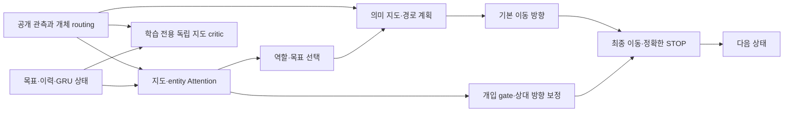

# v11 설계: 목표를 유지하는 계획 제어와 학습 정책의 결합

작성일: 2026-10-24. **계획 수립 완료를 위한 설계 문서이며 v11 모델 구현·학습·성능 달성 보고가 아니다.** 근거는 [리그 분석](../reports/league_findings.md), 실행 순서는 [구현 계획](v11_implementation_plan.md)이다.

> 구현 시 확정한 계약: 사용자의 후속 지시에 따라 최종 제출은 `policy.py`·`checkpoint.pt`이며 공개 두 tensor 입력과 행동 출력을 유지한다. 제공 `run_match`가 `env.agents` 순서로 팀 입력을 구성하고 loader가 이를 보존하므로 canonical 팀 다섯 행으로 개체를 연결한다. 아래 초기 계획의 외부 이름 adapter·임의 행 재배열/partial 호출 검사는 최종 공개 정책에 요구하지 않는다. 경기별 내부 상태와 관측 시계/진영에 따른 reset을 사용한다. 현재 실행법과 구현 범위는 [v11 안내](../README.md)를 따른다.

## 1. 설계 결정

v11은 **v4–v6의 수집·귀환·역할·경로 제어를 ONNX에서 실행할 수 있게 만들고, v9의 작은 Attention으로 목표와 전략을 선택하며, 명시적 상태와 v10의 독립 지도 critic으로 장기 행동을 학습하는 팀 정책**으로 설계한다.

리그 상위권의 공통점은 planner가 포함된 실행 정책이다. v9/v10의 신경망을 더 크게 만드는 것만으로 반납 횟수 약 1~2회와 상위권 약 21회의 격차가 해소된다는 근거는 없다. 반대로 상위권 상호 대진은 모두 5:5이므로 기존 planner의 복제만으로 목표를 달성했다고 보지도 않는다. 기본 행동을 보존하면서 **언제 누구를 어디에 보낼지, 언제 경로를 바꾸거나 위험을 감수할지**를 개선하는 것이 v11의 학습 대상이다.

| 구성 | 기본 채택 | 이유 |
|---|---|---|
| 공개 이름에 따른 개체 routing | 채택 | 자기 위치·목표·기억을 정확히 연결 |
| 상태를 가진 목표·역할·경로 제어 | 채택 | 수집 후 귀환, 정체 회복, 불필요한 방향 변경 억제 |
| 작은 map/entity Attention | 채택 | 팀 상황과 여러 후보 목표의 상대 가치를 학습 |
| 명시적 목표 상태 + GRU | 채택, 각각 제거 대조 | 계획 기억과 관측에서 빠진 최근 이력을 구별 |
| 독립 map critic + PopArt | 채택, vector critic 대조 | actor를 value gradient로 직접 훼손하지 않고 장기 결과 예측 |
| 전략 선택 + 제한된 residual | 채택 | 단기 방향 보정에만 갇힌 v6의 행동 범위를 확장 |
| 여러 checkpoint의 출력 평균 | 기본에서 제외 | KEEP·절대 방향·상대 방향의 의미와 상태가 서로 다름 |
| FlyWire/전뇌 회로 | 기본에서 제외 | 실제 배선 고유의 실력 향상이 검증되지 않음 |
| 전체 planner의 무조건적 BC 대체 | 기본에서 제외 | v3의 높은 분류 정확도와 낮은 실행 성적 반복 방지 |

## 2. 실행과 입력의 개발 기준

[운영진 답변](../../common/organizer_qa_2026-10-24.md)에 따라 ONNX 실행, 내부 구조 자유, 스텝 간 상태 허용을 적용한다. 답변되지 않은 항목은 기존 문서·코드에 근거해 아래처럼 정하고 작업을 진행한다. 재확인 요청을 계획의 선행조건으로 두지 않는다.

### 공개 관측과 routing

- 관측 값은 기존 `vector float32[96]`, `graphic float32[11,96,96]`이고, 행동은 `float32[2]`의 `[-1,1]` 이동 방향이다. 게임·제공 API·관측 전처리를 변경하지 않는다.
- 로컬 `act(obs)`에 이미 있는 `unit_0…unit_9` 키로 팀별 다섯 행을 canonical 순서로 모은다. 행동은 원래 이름으로 되돌린다. `list(obs.keys())`의 우연한 순서를 모델 의미로 쓰지 않는다.
- 현재 Unity의 같은 `Units` 배열을 사용하는 자기 index/관측 생성 관계를 개발 기준으로 채택한다. 팀 sign과 이름으로 자기 entity를 찾고, 아군 각 행의 self-class를 해당 아군에 연결한다. 상대 팀의 별도 관측 행은 읽지 않는다.
- 10개 entity의 순서 변화와 action batch 행의 순서 변화는 다른 문제다. adapter 테스트에서 각각 검사하고, entity에 permutation을 적용할 때 자기 entity index도 함께 변환한다.
- 배터리 수량·상대 class·확정 kill 정보처럼 입력에 없는 값은 알 수 있는 값처럼 넣지 않는다. 상대 class는 unknown 마스크와 관측 이력 기반 추정 분포를 사용하며, 고위험 판단은 불확실성을 반영한다.

내부 표준은 한 stream에 한 팀의 다섯 유닛이다. 모델 core는 팀 축을 명시한 `[N,5,96]`와 `[N,11,96,96]`를 사용할 수 있고, 제출 경계는 기존 `[B,96]`, `[B,11,96,96] → [B,2]`의 행 의미에 맞춘다. 공유 맵 압축은 팀별 동일성이 확인될 때만 한다. 서로 다른 경기의 행을 하나의 팀으로 묶지 않는다.

### 상태의 ONNX 표현

개발용 ONNX는 `observations, state_in, reset_mask → actions, state_out`인 명시적 함수다. 아래 state 포트는 **v11 내부 개발 계약**이며 운영진이 지정한 공식 추가 입력이라고 주장하지 않는다. 최종 I/O는 adapter/manifest에서 맞춘다. Python 객체가 살아 있다는 사실만으로 ONNX 내부 변수가 갱신·보존된다고 가정하지 않는다. [ONNX GRU 명세](https://onnx.ai/onnx/operators/onnx__GRU.html)의 입력 hidden·출력 hidden 방식과 [Runtime API](https://onnxruntime.ai/docs/api/python/api_summary.html)를 참고한다.

| 상태 | 개발용 의미와 형태 | reset |
|---|---|---|
| `unit_hidden` | `[N,5,64]`, 유닛별 GRU 상태 | 경기 시작·해당 유닛 respawn |
| `team_hidden` | `[N,64]`, 적 전략·경제 흐름 요약 | 경기 시작·진영 교체 |
| `goal_cell, intent` | 각각 `[N,5]`, 목표 위치·행동 목적 | 목표 소실/완료/무효, 경기 시작·respawn |
| `role` | `[N,5]`, 지속되는 역할 배정 | 경기 시작; class 변화·respawn에는 유효성 검사 후 필요할 때만 재배정 |
| `goal_age, option_remaining` | `[N,5]`, 목표 지속과 재결정 시점 | 새 목표, interrupt |
| `previous_action, previous_position` | `[N,5,2]`, 정체·방향 안정성 | 경기 시작·respawn |
| `stuck_count, blocked_cells` | 유닛별 짧은 정체 이력·제한된 우회 후보 | 이동 회복·TTL 만료 |
| `previous_time, previous_score` | stream별 시계와 관측 점수 | 경기 시작 |
| `navigation_cache` | 선택 목표의 거리장 등 선택적 tensor 캐시 | 지형/목표/위험 비용/class·크기/임시 blocked 변경, 경기 시작 |

길이·dtype·초깃값·버전은 `state_schema.json`에 한 번 정의하고 export/collector/adapter가 공유한다. 숨은 상태를 checkpoint의 가중치와 혼동하지 않는다. 각 경기·팀에 독립 상태를 배정하고 진영 교체 시 비운다. 이전 단계보다 시간이 증가하면 reset 후보로 진단하되, 명시적인 episode 경계가 주 기준이다. 죽음은 가능하면 제공 이벤트로, 없으면 본진 순간 이동·class/보유 상태 변화로 검출하고 proxy임을 기록한다.

목표 완료만으로 역할을 초기화하지 않는다. worker가 반납을 마치면 다음 수집 목표를 고르되 worker 역할은 유지한다. 거리장 캐시에는 사용한 목표·walkability·비용의 버전을 붙여, 위협이나 class 변화 뒤 오래된 경로 비용을 재사용하지 않게 한다.

같은 입력과 같은 초기 hidden에는 결정론적으로 같은 출력이 나온다. 따라서 ID가 사라진 두 tensor만으로 자기 유닛을 정확히 알아낸다고 설계하지 않는다. 최종 경계가 두 tensor만 받고 state/개체 연결도 제공하지 않는다면 `V11-S` 직접 정책을 별도 호환 모델로 평가할 수 있지만, 그것을 아래 주 모델의 성능과 동일하다고 보고하지 않는다. 주 모델은 현재 로컬 공개 routing·상태 관리로 개발하고 제출 경계 차이는 별도 적합성 결과로 남긴다.

## 3. 구조와 결정 흐름

### 3.1 관측 표현

v9/v10의 4×4 pixel patch를 사용하면 11채널 정보를 모두 담은 `576×176` 입력을 width 64로 투영할 수 있다. 10개 entity token, 점수·남은 시간·흡수 phase 문맥을 붙이고 32개 latent·4 heads·2 blocks의 작은 Attention을 출발점으로 삼는다. 이는 크기 탐색의 초기값이며 더 큰 모델이 기본이 아니다.

자기 query는 class/context만 사용하던 v10과 달리 **자기 위치·보유물·아군 class·목표·이전 행동·GRU**를 포함한다. 팀 정책은 아군 사이의 목표 충돌도 볼 수 있다. entity set에 임의의 학습된 절대 slot 의미를 강제하지 않고, 위치·아군/적·self 마스크로 의미를 준다. routing을 보존한 permutation에 대해 행동도 같은 방식으로 permutation되어야 한다.

맵 좌표는 world `(x,y)`와 top-down pixel `(row,column)` 변환을 명시한다. B 진영 정규화는 게임의 y=x 대칭에 맞춰 좌표·map·행동을 함께 변환한다. 180도 회전으로 대체하지 않는다. 흡수 phase는 `elapsed=420×(1-time_left)`, `elapsed mod 20`을 기초로 하되 부동소수점 경계와 실제 이벤트를 시험한다. 20초 흡수는 새 점수 지급이 아니라 약탈 불가능한 점수 확정이다.

### 3.2 유지할 계획 제어

초기 비교 기준은 v4/v6의 **3 worker + 2 guard**를 명시적으로 동결한다. 다섯 유닛은 각각 목표를 가지며, 빈손 worker는 수집, 보유 worker는 귀환, guard는 성소 이동·변신·요격/순찰을 수행한다. 정체 시 기존 경로를 계속 고집하지 않고 제한된 우회·목표 재할당을 한다. 일정 거리의 적이 있다는 이유만으로 보유 배터리를 파괴하는 Hunter 변신을 선택하지 않는다.

계승하는 것은 Python 객체 자체가 아니라 작동하는 의미다. 다음 요소를 tensor 연산으로 표현한다.

1. 24×24 walkable mask, 적 본진 진입 금지, 대각선 corner cutting 방지, class·크기에 따른 여유 공간.
2. Battery/창고/성소/위협/특수 아이템 후보와 도달 가능성. 관측에서 잠깐 가려진 목표는 즉시 소멸로 확정하지 않고 짧은 TTL과 재관측으로 처리한다.
3. 팀 내 중복 목표 억제와 역할별 목표 용량. 한 배터리에 다섯 유닛이 몰리는 것을 방지하되 요격 대상의 다중 할당은 허용할 수 있다.
4. waypoint 추종, 반납 성공 관측, 창고 수용 실패·보유물 유지 시 다른 창고 선택, 정체 이력과 회복.

첫 ONNX 경로 모듈은 8방향 양의 비용 grid에서 목적지까지 거리장을 계산하는 **bounded min-plus relaxation**이다. 576개 정점의 단순 경로에는 최대 575개 edge가 있으므로 575회 상한을 둔 reference가 grid 최단거리 검증 기준이 된다. 실제 반영하는 이동 비용·금지 셀·대각선 규칙을 Python A*와 맞춘다. 이 수학적 상한이 Unity 연속 충돌의 완전한 재현을 뜻하지는 않는다.

계산량은 초기 위험이다. reference를 먼저 검사하고, 고정 반복 수 축소/검증된 지형별 상수 경로표/거리장 캐시/학습한 경로 모듈을 비교한다. 원본 관측에서 지형이 같다는 확인 없이 특정 벽 구조의 상수를 적용하지 않는다. 64회만 전파하고 전역 최단경로라고 주장하지 않으며, 미도달 셀은 `unreachable`로 표시한다. `Where`를 썼다는 이유만으로 양쪽 분기의 계산이 생략된다고 성능 예산을 잡지 않는다. [Value Iteration Networks](https://arxiv.org/abs/1602.02867)는 계획 연산을 모델에 넣는 참고이며, 여기의 고정 min-plus reference를 해당 논문 그대로의 학습 알고리즘이라고 부르지 않는다.

### 3.3 목표·역할의 학습

처음부터 자유 이동으로 수집 능력을 버리지 않는다. 학습 head는 계획기가 만든 유효 후보의 가치를 평가한다.

- 기본 intent: `collect`, `deliver`, `special`, `intercept`, `defend`, `raid`와 현재 목표를 유지하는 `continue`.
- 창고/배터리 후보 점수: 경로 거리, 귀환 거리, 위험, 아군 경쟁, 흡수까지 남은 시간, 점수차, 현재 보유물, 최근 정체를 사용한다. 보이지 않는 stack 수량을 정확한 입력으로 가정하지 않는다.
- 초기 전략은 3 worker+2 guard이며, 이후 4+1, Carrier 1기 포함, 보호 창고 선호, 특수 아이템 우선순위를 비교한다. Hunter는 바로 worker로 되돌아갈 수 없으므로 role mask는 실제 class·변신 가능성에 맞춘다. Carrier 동시 1기와 보유 아이템 파괴 조건도 반영한다.
- 팀 배정은 5개 유닛을 정해진 순서로 조건부 선택하고 이전 선택에 따라 후보 용량을 mask하는 방식으로 시작한다. 학습의 조건부 log-prob를 그대로 합한다. 선택 후 별도 Hungarian 배정으로 결과를 바꾼 뒤 원래 확률로 PPO를 계산하지 않는다.

목표는 한 번 선택한 뒤 매 frame 새로 뽑지 않는다. 기본 재검토 주기는 25 simulation step(현재 50Hz에서 약 0.5초), continuation 선택을 포함한다. pickup, delivery, 목표 소실, 위험 급증, 정체, respawn에는 즉시 재검토한다. 주기 10/25/50은 작은 대조 실험으로 정한다. 이 수치와 정체 threshold는 문헌의 정답이 아니라 개발 초기값이다.

### 3.4 방향 보정과 개입 확률

기본 방향 `a_base`는 waypoint를 향하는 연속 단위 벡터다. residual은 `KEEP`, 좌/우 45·90·135도, 반대, STOP을 사용한다. 회전 전후의 정규화와 STOP의 정확한 `[0,0]`을 명시한다. planner STOP에서는 중복 회전 대신 절대 8방향을 제공한다.

비교군은 v6의 `KEEP 또는 (5 slots×8 corrections)` 41-way다. 주 모델은 gate와 correction을 분리하고, canonical slot 순서로 **남은 개입 용량을 조건으로** 선택한다. 초기 최대 1유닛, 이후 같은 예산의 최대 2/5유닛 대조로 협동 회피·동시 공격의 가능성을 시험한다. 학습 후 top-margin으로 행동을 취소하지 않는다.

`log π = Σ log π_goal(선택 시점) + Σ[log π_gate + I(개입)×log π_correction]`.

강제 KEEP처럼 선택지가 하나인 mask는 log-prob 0이다. mask·선택 순서·사용한 온도·탐색 mixture를 모두 저장한다. PPO 분모와 재평가 분포가 같은지 update 전 ratio=1로 확인한다. 정체 탈출을 위해 선택한 보정은 기본 4 step 동안 유지하되 이동 자체는 새 waypoint 방향으로 계산한다. 위험·충돌 interrupt 후에는 새 결정을 기록한다. 옵션을 유지한 frame에 그 선택 확률을 또 곱하지 않는다.

학습 시간축은 **목표 재검토(기본 25 step), residual 재검토(기본 4 step), interrupt의 시점 합집합**으로 정의한다. 같은 simulation step에 발생한 여러 재검토는 하나의 decision event다. 위 식의 합은 해당 event에서 실제 재선택한 head에만 적용하고, 계속 유지하는 goal/residual에는 새 log-prob를 붙이지 않는다. ledger는 `event_step`, `active_head_mask`, 선택 전·후 상태, 재선택 결과를 저장한다. 기존에 유지 중인 residual도 개입 용량을 차지하므로 새 선택의 mask는 남은 용량을 기준으로 계산한다.

추론 기본 후보는 목표/개입의 greedy 선택과 결정론적 경로 추종이다. 학습 중 sampling은 탐색을 위해 사용한다. 두 동작이 같다고 주장하지 않고 **greedy와 sampled 전체 실행 정책을 pilot부터 별도로 평가**한다. 선택된 decoder는 confirmation 전 고정하고 최종 제출 때 임의로 바꾸지 않는다. ONNX random 연산이 필요하면 실제 provider에서 검증하고 RNG/seed를 계약에 포함한다.

## 4. 학습: 기본 능력 보존 후 전략 개선

### 4.1 교사 활용과 초기화

v4·v6·v7의 checkpoint를 neural weight만 복사하지 않는다. 해당 checkpoint의 planner·소스·decoder·상태를 포함한 실행 정책을 교사/상대로 동결한다. 그래프 배선은 그대로 합치지 않는다.

먼저 tensor planner의 deterministic closed-loop 성능을 교사와 비교한다. 이후 teacher의 목표·도착·반납·회피를 의미 레이블로 수집하여 Attention 선택기를 초기화한다. 여러 교사의 상충하는 방향 벡터를 평균하지 않는다. 같은 상태에서 선택 가능한 목표의 비용과 성공 여부로 선별하며, 교사의 특권 입력이나 hidden이 student 입력에 없으면 해당 label을 분리하거나 제외한다.

증류가 필요한 경로에는 learner가 방문한 상태를 teacher가 다시 평가하는 DAgger를 적용한다. 목표·보유·정체 상태의 replay를 균형 있게 뽑고, NoOp 다수로 얻은 accuracy를 성공 기준으로 쓰지 않는다. 기존 리그에는 graphic 전체가 매 step 저장되지 않았으므로 17.7M step을 완전한 학습 입력 데이터로 간주하지 않는다. 새 교사 수집에서 필요한 관측과 state를 압축 저장한다. [DAgger 원문](https://proceedings.mlr.press/v15/ross11a.html)의 분포 이동 대책을 쓰되 숨은 정보 차이까지 자동 해결한다고 해석하지 않는다.

### 4.2 recurrent PPO와 critic

학습은 centralized team decision에 대한 recurrent PPO다. 모든 actor가 서로 독립적인 decentralized MAPPO라는 이름을 강제하지 않는다. policy encoder와 critic encoder·optimizer는 분리한다. critic은 공개 팀 관측, 명시 목표/상태, 독립 map 표현을 사용하고 배포물에서 제거한다. 학습 전용 상대 정보를 추가하는 실험은 별도 arm이며 actor 입력으로 넘어가지 않게 한다. MAPPO의 구현 경험은 [PPO 다중 에이전트 연구](https://proceedings.neurips.cc/paper_files/paper/2022/hash/9c1535a02f0ce079433344e14d910597-Abstract.html)를 참고한다.

기본 GRU는 위 합집합 decision event에서만 한 번 갱신한다. 현재 관측을 반영한 hidden 갱신은 행동 선택 전에 수행하며, event 사이의 simulation step에서는 hidden을 그대로 유지한다. planner/FSM의 위치·정체·위험·남은 기간 등 명시 상태는 매 step 갱신하여 interrupt를 감지한다. 따라서 decision 단위 replay만으로도 신경망의 모든 recurrent 갱신을 재현할 수 있다. 매-step GRU를 쓰는 후속 대조는 중간 관측 전체를 저장·재계산하는 별도 계약으로 실행한다.

recurrent sequence는 episode/stream을 넘지 않는 연속 event chunk로 수집한다. 초기 후보는 burn-in 32 decision event, 학습 구간 64 decision event다. 시작 hidden을 보관하고 현재 파라미터로 burn-in을 다시 계산하며, PPO epoch마다 현재 네트워크 출력·hidden을 재계산한다. teacher-forced action은 PPO on-policy 자료에서 제외한다. frozen encoder latent만 보관한 뒤 encoder 학습을 주장하지 않는다.

critic의 `V(s_t)`는 **현재 event의 선택 전 관측·상태**로 계산한다. 이전 event에서 선택하여 유지 중인 목표·보정은 입력 상태에 포함되지만, 지금 새로 뽑은 goal/gate/correction은 같은 결정의 baseline에 넣지 않는다. ledger의 `state_before_decision`과 `state_after_decision`을 구분하고, 목표 값만 바꾼 선택 후 기록이 선택 전 value에 유입되지 않는지 검사한다.

`k`는 현재 decision event부터 다음 합집합 event 또는 자연 종료까지의 simulation step 수다. 그 구간의 primitive reward를 한 번만 할인 합산하고 bootstrap은 `gamma^k`, GAE decay는 primitive-step 기준 `(gamma×lambda)^k`를 사용한다. 목표의 전체 유지 구간과 residual 구간을 따로 중복 합산하지 않는다. 다음 event의 선택 전 state가 bootstrap 입력이며 terminal에서는 0이다. primitive critic을 매 step 계산하는 진단을 추가할 수 있지만 policy loss는 실제 decision event에만 붙인다. 불규칙한 interrupt에서도 동일한 규칙을 적용한다.

collector는 모델 snapshot을 wave 전체에서 동결하고 자연 종료까지 수집한 뒤 한 번 update한다. 완료되지 않은 episode는 다음 wave에 다른 policy를 섞지 않는다. watchdog/중단/비정상 terminal은 유효 PPO 자료가 아니다. 긴 경기의 메모리는 lossless semantic bitpack 또는 검증된 uint8, nonbinary 관측은 float32로 처리한다.

### 4.3 결과 기준과 reward

주 실험의 고정 objective ID는 기존과 같은 `provided_runner_v1`이다. terminal `z=sign(누적 raw reward 차)`만 결과 보상으로 사용하고, 학습용 shaping은 bounded potential 차이로 만든다. 기본 `gamma=1`에서 `r_t=z_terminal+Φ(s_(t+1))-Φ(s_t)`, terminal `Φ=0`, `|Φ|≤0.25`로 하여 전체 return의 끝없는 반복 증가를 막는다. 기본 potential은 관측 점수차이고, 거리/보유 상태 추가는 같은 형태의 별도 ablation이다. rollout chunk 마지막을 terminal로 취급하지 않는다.

동시에 관측 점수차, 점수 기반 승점률, 반납·도달·정체를 측정하고 **raw reward 성능을 올리면서 경제 능력을 잃은 후보는 기본 승격시키지 않는다**. 게임 score/winner를 objective로 쓰는 sensitivity arm은 별도 이름·checkpoint로 실행한다. 향후 공식 승패 규칙을 알게 되면 objective ID를 바꾼 새 실험을 만들며 이전 reward 결과를 공식 승률로 바꾸지 않는다. 제공 reward와 게임 점수 자체는 수정하지 않는다.

희소 terminal이 너무 멀리 전파되는 문제에는 목표 완료 supervision과 trajectory-level return을 보조적으로 사용한다. pickup·kill 수를 무제한 양의 reward로 더해 루프를 유도하지 않는다. residual PPO는 기반 제어 위의 개선을 학습하는 참고 접근이며, 로봇 제어의 성공을 게임 성능 보장으로 옮기지 않는다. [Residual RL 원문](https://arxiv.org/abs/1812.03201).

### 4.4 상대 선택과 망각 방지

리그 참가자를 구조 수가 아닌 전략 가족으로 묶는다. 유사한 planner checkpoint가 다섯 개라는 이유로 학습 또는 평균 성적에서 과대 가중하지 않는다.

초기 능력 단계는 noop/random/collector를 사용하되, 주 학습의 environment-step 목표 비중은 **강한 planner 40%, 기타 scripted 30%, 최근·과거 self-play 20%, v8–v10 직접 정책 10%**다. planner 내부에서 v4/v6/v7 두 후보·고정 기반 controller를 순환한다. self-play snapshot이 아직 없으면 동결 초기 v11로 해당 비중을 채우고 기록한다.

부족한 step 비중의 가족에 새 episode를 배정하는 deficit scheduler를 사용하며 경기 중간에 상대를 바꾸지 않는다. 모든 가족에서 완결 경기 수를 함께 확보한다. 한 wave의 episode cap 때문에 부족분을 채우지 못하면 실제 부족분을 명시하고 다음 wave로 이월한다. 목표 비중을 설정값만 기록하고 달성했다고 간주하지 않는다.

PFSP는 준비된 기본 능력 이후 선택 사항이다. 가족 비중은 유지하고 가족 내부에서 승률이 낮은 상대를 더 뽑되 uniform 20% 하한을 둔다. test 경기 task·맵·행동 seed·결과는 학습 표집과 선택에 사용하지 않는다. 고정 상대 checkpoint는 train/test에서 공통으로 사용할 수 있으며, 이 경우 미관측 맵에서의 평가이지 미관측 상대에 대한 일반화 검증은 아니다. 미관측 상대 평가는 별도로 동결한 상대 집합에서 수행한다. 상위 다섯 모두에 50%에 머무는 후보는 상대군 macro 평균만으로 최강 판정을 받지 못한다. league 다양성의 원리는 [AlphaStar 연구팀 설명](https://deepmind.google/blog/alphastar-grandmaster-level-in-starcraft-ii-using-multi-agent-reinforcement-learning/)을 참고한다.

## 5. ONNX를 처음부터 검증하는 방법

최종 단계에 export를 붙이지 않는다. 상태를 갱신하는 작은 core와 planner 조각부터 `torch.onnx.export`로 변환하고 Runtime에서 실행한다. PyTorch 문서는 `dynamo=True`, dynamic shape 지정, 검증 옵션을 안내한다. 실제 설치 버전과 provider/opset을 pin한 probe가 기준이며 웹 문서의 최신 기본값을 로컬에 그대로 가정하지 않는다. [PyTorch ONNX 문서](https://docs.pytorch.org/docs/stable/onnx/).

- 그래프 내부는 tensor 기반: Python dict, NumPy A*, 파일 읽기, 환경 객체, `bool(tensor)` 분기, mutable Python cache에 의존하지 않는다.
- Attention은 필요하면 MatMul/Scale/Softmax/MatMul로 명시해 fused 연산 export 의존성을 줄인다. 검증된 고정 길이 loop 또는 지원되는 ONNX Loop만 사용한다.
- 초기 port는 FP32다. quantization·FP16은 나중의 별도 후보로 동등성·성능을 검증한다.
- PyTorch와 ONNX의 logits·action·state를 같은 녹화 관측 sequence에서 비교한다. 한 번의 forward 통과만으로 수천 step의 상태 일치를 인증하지 않는다.
- 동률·거의 동률 argmax, STOP, all-masked 후보, 빈 후보, respawn, 두 경기 interleave, 진영 교체, 입력 순서 변경을 포함한다.
- 연속 값 초기 허용오차는 `atol=1e-5, rtol=1e-4`. 최종 결정이 달라진 사례는 따로 기록하고 재현한다. logits 허용오차만으로 closed-loop 승패 parity를 주장하지 않는다.
- batch 1/3/5/10은 **외부 adapter의 분할·모으기·routing** 시험이며, 주 core가 완전 팀 5개를 요구하면 잘못된 팀 batch를 거부한다. 지원할 수 없는 partial call을 임의 hidden에 연결하지 않는다.

## 6. 검증할 가설과 채택 규칙

| 가설 | 필요한 대조 | 실패하면 |
|---|---|---|
| 실행 중 자기 위치/목표 연결이 병목 | 같은 encoder·예산의 ID 없음/있음 | 식별만으로 해결됐다고 주장하지 않고 목표 수행 단계 분석 |
| 지속 목표가 방향 진동을 줄이고 반납을 높임 | per-step 선택 대 지속 목표 | 기간·interrupt를 조정; 단순 행동 반복으로 교체했다고 숨기지 않음 |
| GRU가 명시 목표 상태 이상의 정보를 줌 | 목표 상태만 대 목표+GRU | 비용 대비 이득 없으면 GRU를 최종 후보에서 제거 |
| learned 목표가 고정 planner를 개선 | planner-only 대 목표 학습, residual 동일 | 기반 정책 보존 후 목표 후보·reward credit 점검 |
| 다중 유닛 residual이 협동을 개선 | 41-way/최대1 대 최대2/5 | 제한을 확대하지 않음 |
| map critic가 policy 개선에 기여 | 동일 actor/init·노출에서 vector/map/map-blind | value loss만 좋아졌다면 critic 인과 이득 주장 금지 |
| 상대 step 균형이 강자 대응을 개선 | episode 균형 대 step deficit | 실측 노출·완료 경기·학습 가중치로 원인 점검 |

최종 목표는 평균 승률 숫자 하나가 아니다. 기존 최강권에 대한 개선, 모든 약한 상대의 기본 대응, 양 진영의 성능, seed 간 재현성, 점수 경제의 비퇴행, ONNX 실행의 일치를 함께 통과해야 한다. 5개 paired map에서 10/10이라는 결과도 일반화의 확신으로 과장하지 않는다. 불확실성·다중 seed 보고는 [RL 평가 연구](https://arxiv.org/abs/2108.13264)를 참고한다. 수치 gate와 실험 예산은 [구현 계획](v11_implementation_plan.md)에 고정한다.

위 외부 자료는 2026-10-24 열람했다. 문헌은 설계 원리의 근거이며 BlackOut의 성능 증거는 아니다. 차원·주기·비중·threshold는 이 프로젝트의 제안값이다.
