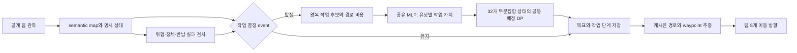

# v12 설계: 왕복 작업의 공동 배정과 작은 효용 모델

작성일: 2026-10-26. **구현에 앞서 작성한 설계**다. 현재 구현 범위와 차이는 [구현 기록](../reports/implementation.md)에 둔다. 수치 근거는 [풀리그 재분석](../reports/league_findings.md), 구현 순서와 채택 조건은 [검증 계획](v12_implementation_plan.md)을 따른다. 아래 차원·주기·비용 계수·예산은 프로젝트의 초기 제안값이며 실측 최적값이 아니다.

## 1. 선택한 방식

**경로를 따라 움직이는 일은 검증된 제어기에 맡기고, 작은 공유 신경망은 ‘이 유닛이 이 작업을 맡는 가치’를 평가한다. 5개 유닛의 작업 조합은 정확한 부분집합 DP로 선택한다.**

개선 대상은 좋은 모델의 동작을 더 큰 망에 모으는 것이 아니라, 그 모델들이 공유한 **편도 후보 절단과 greedy/순차 배정**이다. 왕복 완료시간·상대 선점 가능성·변신의 수집 기회비용을 명시적인 입력으로 만든다. 역할은 미리 3+2로 정한 정체성이 아니라 실제 class와 현재 맡은 작업으로 표현한다.

기본 actor는 `Linear(64,64) → ReLU → Linear(64,32) → ReLU → Linear(32,1)` 하나다. Attention·CNN·GRU·primitive direction residual·앙상블은 없다. 상태가 없다는 뜻은 아니다. 목표·작업 단계·이전 위치·실패 창고·경로 캐시를 명시적으로 유지한다.

| 축 | v11의 주 설계/구현 | v12의 결정 |
|---|---|---|
| 학습 표현 | map/entity Attention + unit/team GRU | 공개 관측에서 계산한 유닛–작업 feature + 공유 MLP |
| 후보 생성 | intent별 편도 top5 + continue | 진행 중 작업 보존 + 왕복·경합 기준의 다양한 후보 |
| 팀 배정 | canonical slot 순 조건부 선택 | 전체 5유닛의 capacity-constrained 배정 분포 |
| 역할 | 3+2 시작, role head로 변경 | Collector 유지와 변신을 작업 가치로 비교 |
| 이동 제어 | planner + 학습 방향 보정 | planner/FSM와 고정된 정체·위협 회복 |
| 의사결정 | goal/residual event 합집합 | 작업 event, 기본 25 step 및 interrupt |
| 학습 | recurrent PPO | 명시 상태를 입력한 event PPO, joint log-prob |
| 주 가설 | 목표 기억·표현·제어 결합 | 후보의 질과 공동 배정이 작은 망의 한계를 보완 |

목표 유지·왕복 고려·상대 다양성·상태 허용은 이미 v11에 있다. v12의 차별성은 **작은 표현과 정확한 조합 선택으로 학습 부담을 옮기는 것**이다. v11 성능이 나쁘다고 전제하지 않으며, 사용 가능한 동결 checkpoint가 생기면 같은 조건에서 비교한다.

## 2. 계승할 장점과 보완할 약점

| 출처 | 계승 | 보완 |
|---|---|---|
| v4 | 단순한 기반 제어, 수집–귀환 완주 | 단기 방향 override보다 작업 배정 자체를 변경 |
| v6 | 상태·이력과 제한된 개입 | 필요한 이력을 수치 ledger로 제한하고 큰 neural memory 제거 |
| v7 | 역할 분담과 유효한 실행 규칙 | 회로 구조의 효과는 입증되지 않아 이식하지 않음 |
| v9/v10 | 작은 actor 지향, 분리된 critic의 원칙 | 같은 입력에서 자기 유닛 연결, 안정된 경로 추종을 유지 |
| v11 | 관측 계약, 목표 유지, score/reward 분리, duration-aware return | 순차 우선순위·후보 pruning·event 외 planner 계산을 직접 개선 |

상위 모델의 frozen 실행 정책은 기준선·상대·작업 데이터 출처로 사용한다. 학습 가중치나 상충하는 이동 벡터를 평균하지 않는다. v3처럼 teacher의 neural core만 복사하고 planner 능력까지 복사됐다고 간주하지 않는다.

## 3. 입력과 실행 계약

[현재 v11 안내](../../v11/README.md)와 [운영진 답변](../../common/organizer_qa_2026-10-24.md)을 따른다.

- 공개 입력은 `vector float32[B,96]`, `graphic float32[B,11,96,96]`, 출력은 `action float32[B,2]`다. 현재 runner의 **canonical 팀 다섯 행**으로 자기 entity를 연결한다.
- 아군 다섯 행에서 각각의 self-class를 연결할 수 있다. 상대 class·배터리 stack 수량·숨은 게임 상태는 추가하지 않는다.
- 입력 map의 팀 내 동일성을 확인한 뒤 한 번만 decode한다. 모델 내부 24×24 semantic 표현은 기존 공개 관측을 사용하는 연산이며 제공 게임/API/관측 전처리를 바꾸지 않는다.
- Team B 정규화는 기존 게임의 `y=x` 반사다. 좌표·map·행동·목표·캐시를 함께 변환한다. 180도 회전으로 바꾸지 않는다.
- Unity는 nonzero action을 정규화하므로 작은 벡터로 감속하지 않는다. 정지는 정확한 `[0,0]`이다.
- 한 policy instance는 한 팀 stream을 소유한다. 경기·진영 교체는 전체 reset, respawn은 해당 유닛 작업과 상태를 reset한다. 시계 증가·진영 변화 검출과 명시 reset을 같이 시험한다. 이 계약으로 임의 partial/shuffled batch를 지원한다고 주장하지 않는다.
- 내부 개발 ONNX는 `obs,state_in → action,state_out`이다. Python 멤버 상태가 ONNX 안에서 자동 보존된다고 가정하지 않는다. 현재 두 파일 `policy.py`, `checkpoint.pt`와 개발 ONNX를 분리한다. 최종 서버의 state 전달 규약은 아직 인증되지 않았다.

## 4. 정책의 흐름



### 4.1 작업은 ‘그 칸 도착’보다 길다

수집 작업은 `배터리 접근 → 획득 확인 → 아군 창고 이동 → 반납 확인`이다. 유닛별 예상 목적 창고도 함께 정한다. 획득 전 source 배터리가 사라지면 취소/재계획하고, 획득 후에는 그 배터리 칸이 사라져도 귀환을 계속한다. 창고에 도착했는데 계속 보유 중이면 기다림 상한 뒤 실패 창고를 기록하고 대체 창고를 선택한다.

경로 비용 `d`를 게임 시간으로 바꿀 때 `T_go=d(unit,source)/v_eff`, `T_back=d(source,storage)/v_eff`, `T_trip=T_go+T_back+T_service`를 사용한다. 속도·service time은 공개 위치 이력과 실제 완료 기록으로 보정한다. 벽 충돌, 특수 효과와 연속 좌표 오차 때문에 정확한 도착시간이라고 주장하지 않는다.

같은 배터리를 서로 다른 귀환 창고와 결합해 독립 task 여러 개로 만들면 두 유닛이 같은 자원을 차지할 수 있다. **하나의 source는 하나의 resource task**로 유지하고, unit–task edge마다 합법적 창고 중 고정된 안전/시간 기준으로 destination을 정한다. 이 선택 함수는 학습 중 고정·기록한다. 창고 선택을 learned action으로 확장하는 실험은 별도 지원집합이 필요하다.

자동 pickup으로 상태가 바뀌면 collection reservation을 해제하고 해당 유닛의 귀환 단계로 전환한다. 이 FSM 전이는 새로운 확률적 선택이 아니다. 다음 작업 event에서 창고 변경을 허용했다면 그때의 배정 확률만 기록한다.

### 4.2 작업 종류와 용량

| 작업 | 대상과 eligibility | 기본 capacity 의미 |
|---|---|---|
| collect-trip | 빈손 Collector/Carrier → 중립 Battery source | source당 1, 중복 추격 방지용 정책 제약 |
| deliver | 아이템 보유 Collector/Carrier → 아군 창고 component | 최대 5; 실제 창고 잔여 수용량을 안다는 뜻 아님 |
| special-trip | 빈손 수집 가능 유닛 → 특수 아이템 | source당 1 |
| intercept | Hunter → 공개 위치의 적 | 목표당 2, 검증할 전술 상한 |
| defend | 유닛의 현재 class로 가능한 위치 → 위협받는 수집선/창고 | 거점당 2, 수집 불능 class의 합법적 순찰 포함 |
| raid-trip | 빈손 수집 가능 유닛 → 접근 가능한 적 창고 Battery | 자원 source당 1, 보호 본진 진입 금지 |
| transform-Hunter | 빈손 Collector → 중앙 성소 | 기존 예약 포함 `max(0, 2−실제 Hunter 수)` |
| transform-Carrier | 빈손 Collector → 본진 성소 | 기존 예약 포함 `max(0, 1−실제 Carrier 수)` |
| private hold | 해당 유닛만 사용, 현재 안전 제어 유지 또는 STOP | 유닛별 1 |

Hunter 상한 2와 intercept/defend 상한은 게임 규칙이 아닌 초기 실험 설정이다. 기존 guard 수를 상시 고정하지 않되, 모두 Hunter가 되는 붕괴를 먼저 방지한다. 상한 1/3 대조는 선택 실험으로 둔다. Carrier 동시 1기는 실제 게임 제약이다.

변신 task는 단일 resource로 두어 여러 Collector의 예약을 동시에 제한한다. `c_H=max(0,H_max−actual_H)`, `c_C=max(0,1−actual_C)`는 **기존 예약을 포함한 총 task capacity**다. 진행 중 변신에 묶인 유닛은 같은 task에 배정되고 이 용량을 차지한다. 신규 가용량만 `c−locked_reservations`이며, DP capacity에서 예약을 다시 빼지 않는다. 물리 class 전환 전까지 reservation을 유지하고, 사망·취소·완료 시 해제한다. 운반 중 변신은 금지한다. 변신 의도가 없는 Collector의 경로가 성소를 통과해 자동 변신하지 않도록 walkability도 일치시킨다.

private hold는 유효 배정 부재를 막기 위한 수단이다. 짧은 안전 회피/대기만 수행하며, 예약을 해제한 수집·변신 목표를 계속 추격하는 우회 선택지가 아니다. 위협 시 고정 안전 회피를 실행할 수 있으나 보이지 않는 적 class를 확정하지 않는다. hold 성공률만 높은 정책을 채택하지 않도록 trip 처리량·승패를 함께 평가한다. 규칙 제어가 작업을 interrupt하면 다음 event를 기록하고, 사후에 다른 learned 배정으로 바꾸지 않는다.

### 4.3 후보 절단을 먼저 개선한다

기본 최대 작업 수는 **24개 = 공유 작업 최대 19개 + private hold 5개**다. 없는 작업은 padding하고 `capacity=0`으로 막는다. task ID는 종류·source/component·실제 의미로 정규화하고 중복을 제거한다. continue는 동일 task의 edge에 전환 비용으로 반영하며 독립 복제하지 않는다.

후보 보존 우선순위는 다음과 같다.

1. 유효한 진행 중 작업과 잠긴 변신 예약을 우선 보존한다. 보유 유닛마다 도달 가능한 반납 선택지를 적어도 하나 보존한다.
2. 각 빈손 유닛의 **왕복 시간 상위 후보**, 상대보다 먼저 도착할 여지가 있는 후보, 안전 귀환 후보를 합친다. 특정 slot부터 목록을 채우지 않고 팀 전체 순위와 고정 task ID로 정렬한다.
3. 특수 아이템·변신·현재 위협에 필요한 방어 후보를 보존한 뒤, 남은 자리를 정규화된 기준으로 채운다. 우선순위/상한은 config hash에 포함한다.

진행 중 작업 최대 5개와 팀 창고 최대 5개, private hold 5개는 24개 안에 들어간다. 나머지 선택에서는 후보 누락이 여전히 가능하다. 더 넓은 합법 후보를 오프라인으로 점수화해 **고가치 후보 누락률**을 측정하고 16/24/32 task를 dev에서 비교한다. 이 reference 역시 점수모델 아래의 비교이며 숨은 실제 최적 행동 oracle이 아니다. 필수 후보가 예외적으로 상한을 넘으면 조용히 잘라내지 않고 계약 실패를 기록한다.

## 5. 작은 모델이 읽을 정보

기본 입력은 unit–task마다 64개다. 각 값의 단위·범위·unknown 처리·schema version을 고정한다. 화면 픽셀을 학습 인코더로 다시 압축하지 않는다.

| 묶음 | 차원 | 구성 |
|---|---:|---|
| 유닛 상태 | 12 | class 3, holding 6, 유효 속도 추정, 정체 기간, 작업 나이 |
| 작업 의미 | 12 | 위 작업 종류 9, 관측 유효성, 목표 기억 나이, 보호 창고 여부 |
| 경로·완수 | 16 | 편도 거리, 귀환 거리, 총 ETA, 전환 비용, 최소 통로 여유, 경로 fallback, 대체 작업 비용 차, 적 ETA 하/상한, 선착 margin 하/상한, 경로 위험, 창고 실패, 비용 stale, 기존 목표 거리, 도달 가능성 |
| 팀·시간 | 16 | 양 팀 점수 2, 남은 시간, 흡수 sin/cos 2, 아군 class 수 3, 보유 유닛 수, 보이는 Battery 타일 수, 도달 가능한 작업 수, 보이는 특수 종류 4, 최근 점수차 변화 |
| 이력·경합 | 8 | 이전 목표/intent 일치 2, respawn proxy, 보유물 변화, 다른 아군의 최선/차선 ETA 2, 추정 불확실성, 목표 수요 |
| 합계 | **64** | 모두 공개 관측과 그 이력에서 계산 |

마지막 두 열의 ETA·위험·대안 비용은 인과적 반사실 결과가 아니라 모델의 예측/계산값이다. 상대 속도는 최근 변위와 물리적으로 가능한 범위로 추정하고, 정지한 적의 class를 Collector로 확정하지 않는다. 상대 ETA 상한을 신뢰할 수 없으면 unknown/sentinel과 불확실성 feature를 사용한다. 그런 값으로 수집 edge를 영구 금지하지 않는다.

거리·시간은 clipping/scale로 정규화한다. unknown은 실제 0과 구별하는 고정 부호/예약값 및 불확실성 feature를 사용한다. task별로 정의되지 않는 feature도 동일 schema로 처리한다. 좌표의 절대 slot ID는 입력하지 않는다. class 수·평균·최소 비용 등 팀 문맥은 순열에 무관한 집계로 만든다. 공유 함수와 집합 표현의 원리는 [Deep Sets](https://proceedings.neurips.cc/paper_files/paper/2017/hash/f22e4747da1aa27e363d86d40ff442fe-Abstract.html)를 참고하지만, 이 수작업 요약이 모든 전략 정보를 보존한다는 보장은 없다.

### 초기 효용과 학습 점수

`s_ij = b_ij + fθ(x_ij)`를 사용한다. `b`는 task별 고정 prior, 시간·위험·전환 비용으로 된 초기 작업 점수이며 `fθ`의 마지막 layer를 0으로 시작한다. 각 항과 합계를 유한 범위로 제한하고 normalization을 train split에서 고정한다. 초기 prior의 정확 계수는 no-learning pilot에서 결정해 본학습 전에 동결한다.

수집·특수·약탈에는 완수까지 시간과 귀환 위험을, 변신에는 남은 시간 동안 포기할 수집 기회와 방어 필요를 입력한다. **순간 점수/초를 새로운 RL 보상으로 최적화하지 않는다.** 실제 return 목적은 §8에 둔다. 정확한 보유 수량이나 kill 성공을 초기 prior에 넣지 않는다.

공동 배정 자체가 유닛 간 차선책을 비교하므로 같은 기회비용을 edge 점수에서 반복 차감하지 않는다. ‘이 유닛을 변신시키지 않았을 때의 가치’ 역시 현재 점수모델의 대안 차이일 뿐 실제 게임의 반사실 결과라고 부르지 않는다.

## 6. 정확한 공동 배정과 확률

유닛 집합 `U={0,…,4}`, 작업 `j=1,…,M`, 작업 용량 `c_j`를 둔다. 유효 배정 `a`는 각 유닛에게 작업 하나를 주고 모든 capacity·eligibility·commitment를 만족한다. 가치가 가산형일 때:

```text
V(a) = Σ_i s[i, a_i]
π(a | x) = exp(V(a) / τ) / Z(x)
```

유닛의 부분집합은 `2^5=32`개다. `F_j(S)`는 앞의 j개 작업에 유닛 집합 S를 배정하는 모든 경우의 log partition이다.

```text
F_0(∅)=0, F_0(S≠∅)=−∞

F_j(S) = logsumexp over A ⊆ S,
                         |A| ≤ c_j,
                         A의 모든 유닛이 j에 합법:
             F_(j−1)(S\A) + Σ_(i∈A) s_ij / τ

log Z = F_M(U)
log π(a) = V(a)/τ − log Z
```

빈 집합 A는 해당 작업을 사용하지 않는 전이다. task를 뒤에서부터 역추적하며 위 항들의 조건부 확률로 A를 sample하면 같은 Gibbs 배정 분포를 얻는다. 추론의 기본 후보는 `logsumexp→max`로 바꾼 DP와 backtracking을 사용하는 결정론적 MAP다. sampled와 MAP는 다른 decoder이므로 모두 dev에서 평가하고 test 전 하나를 동결한다.

**용량 2인 task를 동일 task 두 개로 복제하지 않는다.** 그러면 같은 의미 배정이 여러 번 세어져 학습 확률이 달라진다. 위 subset 전이로 용량을 직접 처리한다. locked 유닛은 현재 task edge만 합법으로 두고, 예약도 이 배정 안에서 용량을 차지하게 한다. 고유 최적해에서는 unit 행을 permutation했을 때 같은 배정이 대응해야 한다. 완전 동률은 안정된 물리 unit/task ID로 정하고 동률 빈도를 기록한다.

DP의 정확성 범위는 **주어진 후보, 가산 edge 점수, task별 제약**이다. 경로 교차·두 유닛의 협공·상대의 전략 반응을 전역 최적으로 푸는 알고리즘은 아니다. 이 상호작용은 feature와 반복 재계획의 근사에 남는다. 먼저 같은 후보·scorer의 순차 배정과 비교한다.

미분 가능한 구조적 DP의 log partition/MAP/marginal 구분은 [Torch-Struct](https://aclanthology.org/2020.acl-demos.38/)를 참고했다. 위 capacity 부분집합 recurrence는 이 프로젝트에 맞춘 설계이며 그 논문의 기존 BlackOut 알고리즘이라고 주장하지 않는다.

### PPO 정합성

- 실제로 sample한 **전체 배정 하나의 log-prob**를 저장한다. 개별 독립 확률을 쓴 뒤 Hungarian/greedy로 출력을 고치는 방식은 사용하지 않는다.
- replay에는 64차원 feature, task ID/목적지, capacity, legal/locked mask, 고정 prior, 온도, 실제 배정, old log-prob, 상태 schema를 저장한다. update 중 task를 다시 생성하지 않는다.
- PPO update 전 동일 parameter에서 ratio=1을 확인한다. 강제 실행만 가능한 event의 확률은 1이다. task를 유지한 일반 frame에는 새 log-prob를 붙이지 않는다.
- joint entropy는 DP marginal로 `H=logZ−Σ_ij p_ij(s_ij/τ)`를 계산하거나 초기에는 entropy 항을 꺼서 구현 범위를 제한한다. sample의 `−logπ`를 그대로 미분해 정확한 entropy gradient라고 부르지 않는다.
- 모든 edge가 불가능한 내부 DP 상태는 별도 validity mask로 다룬다. max를 뺀 안정적 LSE와 all-invalid 처리를 사용해 `−∞−(−∞)` NaN을 피한다.

### 설계 단계 산술 검산

3유닛/4task, `τ=.7`, capacities `[1,2,1,3]`, 점수 `[[1.2,.7,-.4,0],[.9,1.1,.2,0],[-.3,.6,1.4,0]]`, 불법 edge `(u0,t2),(u2,t0)`를 전수열거와 대조했다.

- 유효 배정 29개, DP logZ `6.5988516569678035`, 전수열거 `6.598851656967804`.
- MAP 모두 점수 3.7, 배정 `[0,1,2]`, 확률합 `1.0000000000000002`.
- backward 조건부 확률과 joint 공식 차이 최대 약 `8.9e−16`.
- 유닛 행 `[2,0,1]` 순열에서 logZ/MAP는 같고 배정만 대응해 바뀌었다.

JavaScript 수치 검산이며 PyTorch autograd·ONNX 실행·게임 성능 테스트가 아니다. 실제 구현에서 gradient·mask·수치 정밀도 시험을 별도로 수행한다.

## 7. 모델·상태·경로 계산의 경량 예산

### 7.1 신경망 크기

```text
64→64: 64×64 + 64 = 4,160
64→32: 64×32 + 32 = 2,080
32→ 1: 32× 1 +  1 =    33
합계                    6,273 parameters
FP32                    25,092 bytes ≈ 24.5 KiB
```

v11 전체 actor 194,327개 대비 약 96.8%, v10 120,905개 대비 약 94.8% 감소다. critic·auxiliary head·상수 buffer를 제외한 같은 범주의 가중치 비교다. FP32를 기본으로 하고 양자화는 필요성과 실제 속도 이득이 확인될 때만 별도 시도한다.

M=24일 때 최대 120 edge의 affine MAC는 event당 `120×(4096+2048+32)=741,120`이다. feature 생성·activation·DP·경로·메모리 이동을 뺀 산술값이며 모델 전체 FLOP나 속도가 아니다.

DP의 유효 subset 전이는 최대 `24×3^5=5,832`개, FP32 전체 이력은 `25×32×4=3,200 bytes`다. dense padded ONNX는 최대 `24×32×32=24,576`개 항을 계산할 수 있다. 실제 graph와 provider profiler로 확인한다.

### 7.2 실행 비용의 우선순위

| 항목 | 기본 예산/목표 | 검증 방식 |
|---|---|---|
| actor trainable parameters | 6,273; 기본안 상한 10,000 | 실제 parameter 수 |
| checkpoint 전체 | 256 KiB 이하 목표 | buffer·metadata 포함 파일 크기 |
| ONNX 전체 | 2 MiB 이하 목표 | graph·initializer 포함; 초과 시 원인 공개 |
| 팀 지속 상태/캐시 | 256 KiB 이하 목표 | tensor별 dtype×shape 합 |
| steady-state 팀 추론 | 같은 호스트 v4 및 v11보다 p50/p95 모두 작음 | 같은 sequence·threads·batch, PyTorch/ORT 각각 |
| 실제 경기 처리량 | 동일 worker/상대에서 악화 5% 이내 | IPC·렌더링 포함 steps/s |

위 예산은 달성 보고가 아니다. 작은 checkpoint만 통과하고 경로 계산이 느리면 경량 성공으로 판정하지 않는다. 신규 맵 cold-start와 변경 event의 p99/max도 따로 보고한다.

### 7.3 경로 캐시

매-step 안전 검사와 waypoint 추종은 유지하되, 기본 25 step(현재 50Hz에서 약 0.5초)의 작업 event 및 중요한 interrupt에서만 scorer·DP를 호출한다. pickup/반납·목표 소실·위협 급변·정체·창고 실패·respawn이 interrupt다. 스케줄은 관측 시계와 실제 step 양쪽으로 검증한다.

거리장은 다음 원칙으로 요청한다.

1. 현재 유닛→모든 후보의 편도 비용은 유효한 현재 이동 profile의 source field로 한 번에 읽는다. 역할 3개를 모든 유닛에 무조건 적용하지 않는다.
2. 동일 profile에서 가장 적합한 아군 창고까지의 귀환 비용은 multi-source field와 목적 창고 owner로 얻는다. 안전 창고/가까운 창고가 다른 비용이라면 서로 다른 field로 구분한다.
3. 실행 중 목표의 reverse field는 그대로 유지하고 목표·walkability·금지 성소·class/크기·임시 blocked·비용 버전이 바뀔 때만 폐기한다. 후보 24개 모두의 reverse field를 매 event 생성하지 않는다.
4. 위험 feature 변경과 지형 경로 변경을 구분한다. 동적 위험을 경로 비용에 넣었다면 그 변화도 cache key에 반영한다. 다른 profile을 무리하게 공유하지 않는다.

기본 경로 reference는 기존 24×24 8방향 양의 비용 min-plus와 동일한 대각선 금지 규칙이다. 최대 575회와 수렴 조기 종료를 유지해 정확성을 먼저 확보한다. 임의로 64회로 줄여 전역 최단경로라고 보고하지 않는다. 전체 all-pairs 경로표를 checkpoint에 내장해 파일을 키우거나, 리그의 벽 1종을 보편적 고정 지형이라고 가정하지 않는다.

ONNX의 event skip은 실제 [If](https://onnx.ai/onnx/operators/onnx__If.html) subgraph나 검증된 호출 경계로 구현한다. `Where`로 결과만 고르면서 두 경로를 계산한 것을 cache hit라고 세지 않는다. 경로 반복에는 [Loop](https://onnx.ai/onnx/operators/onnx__Loop.html), DP에는 고정 index Gather와 [ReduceLogSumExp](https://onnx.ai/onnx/operators/onnx__ReduceLogSumExp.html) 계열을 사용할 수 있다. 연산 명세의 존재가 로컬 exporter/provider 지원이나 속도를 보장하지 않으므로 초기에 실제 export probe를 한다.

### 7.4 필요한 기억만 보존

유닛별 task ID·source/destination·phase·목표 나이·commitment 잔여시간·이전 위치/행동/보유/class·정체 수·실패 창고 TTL, 팀별 이전 시계/점수·자원 TTL·변신 예약·지도/거리장 버전을 저장한다. 상대 최근 위치와 ETA 범위 추정을 위한 짧은 통계도 포함한다. GRU hidden과 raw history stack은 저장하지 않는다.

목표를 매 event마다 불필요하게 바꾸지 않도록 짧은 commitment와 전환 비용을 사용한다. commitment는 **선택 전 legality**, 전환 비용은 **선택 전 점수**에 반영한다. 선택 뒤 이전 목표로 되돌리는 후처리는 하지 않는다. 위험/불가능한 목표에는 commitment를 해제하고 새 event를 만든다.

## 8. 학습: 기본 제어를 보존하며 배정만 개선

### 8.1 데이터와 초기화

먼저 learned scorer=0인 고정 점수 공동 배정으로 완주 능력을 검사한다. v4/v6 및 새 정책의 공개 관측에서 task·선택·보유 변화·도착/반납 proxy·왕복시간을 수집한다. 데이터는 새로 수집하며 HTML의 모든 step에 완전한 graphic이 있다고 가정하지 않는다.

이 데이터는 feature scale, 초기 prior, ETA 보정, 선택적인 작업 ranking warm-start에 쓴다. 교사가 어떤 작업을 선택했는지는 행동 label이지 그 대안보다 좋았다는 인과 label이 아니다. 명확한 trip 완료만 보조 성공 label로 사용하고 동시 사건·사망과 반납이 모호하면 auxiliary loss에서 제외한다. 하지 않은 작업의 실패 label을 임의 생성하지 않는다.

교사의 모든 primitive action을 BC로 모사하지 않는다. 보조 성공/ETA head가 필요하면 32차원 hidden에 학습 전용으로 붙이고 최종 배포에서 제거한다. teacher-forced 데이터는 on-policy PPO 자료에서 분리한다.

### 8.2 팀 event PPO

actor의 입력은 현재 명시 상태에서 계산한 feature다. GRU가 없어 burn-in은 없지만 경기 경계를 넘는 return을 만들지 않는다. 독립적인 작은 team critic은 공개 관측의 집계와 명시 상태를 사용하고 actor와 optimizer를 분리한다. 기본은 map Attention critic을 가져오지 않는다. critic 크기를 늘리는 대조는 actor 배포 비용과 분리한다.

한 event부터 다음 event까지 k simulation step의 reward를 한 번만 합산한다. bootstrap은 `γ^k`, GAE는 primitive-step 기준 `(γλ)^k`를 쓴다. 기본 `γ=1`, `λ=.9975`를 v11 비교값으로 시작한다. option 유지 frame에 반복 policy loss를 붙이지 않는다. 이러한 시간 추상화의 근거는 [Options 원 논문](https://people.eecs.berkeley.edu/~russell/classes/cs294/f05/papers/sutton%2Bal-1999.pdf)이며, 시간 처리는 v11에서도 이미 채택한 원칙이다.

완결 episode wave 동안 behavior snapshot을 동결한다. 중단/오류/다른 policy가 섞인 episode를 PPO에 넣지 않는다. 과거 경험의 feature를 현재 후보 생성기로 바꿔 replay하지 않는다. primitive frame당 용량이 아니라 **실제 결정 event 수와 환경 step 모두**를 학습 예산에 기록한다.

### 8.3 목적과 상대

주 실험 objective는 현재 확인 가능한 `provided_runner_v1`을 유지한다. terminal 보상은 `z=sign(누적 raw reward 차)`이고 shaping은 `r_t=z_terminal+Φ(s_(t+1))−Φ(s_t)`, `|Φ|≤.25`, 자연 terminal `Φ=0`의 관측 score potential로 둔다. `γ=1`에서 중간 potential이 상쇄되어 수집/kill 반복 자체에 무제한 이득을 주지 않는다. chunk 경계는 terminal이 아니다.

관측 score 기반 성적, 실제 trip 처리량과 진영별 성적을 별도 평가한다. raw reward를 올리면서 score 경제를 크게 잃은 모델은 승격하지 않는다. 공식 판정이 확인되면 objective ID를 바꾸어 새 실험을 등록한다. 관측 score를 공식 승패라고 재명명하지 않는다.

주학습의 초기 step 비중은 강한 planner 40%, 기타 scripted 30%, self/history 20%, v8–v10 직접 정책 10%다. 이는 v11과 공유하는 통제 조건이다. 가족 내 균등 표집으로 시작하고 긴 경기가 노출을 지배하지 않도록 실제 step deficit을 기록한다. 같은 planner 계열 checkpoint 수가 많다고 과대 가중하지 않는다. 최종 test seed/결과로 상대 표집이나 모델을 수정하지 않는다.

## 9. 예상되는 실패와 대응

| 실패 | 진단 | 대응 |
|---|---|---|
| MLP가 작아 방어 판단을 못함 | fixed scorer 대비 변화/완수·피해·score 분리 | feature 누락부터 수정; 망 확대는 별도 arm |
| DP는 좋아 보이나 게임 성적 그대로 | 실행 배정 변경률·counterfactual score gap·trip 결과 | proxy 효용/후보 제한 점검; 학습 기여 없으면 고정 모델 채택 |
| 목표를 자주 갈아탐 | 이벤트당 변경률·미완료 trip·전환 비용 | legality와 switch cost를 조정하고 재등록 |
| 변신을 전혀 하지 않음/너무 많이 함 | 시간별 class·경제·방어 피해 | 고정 3+2 대조, transform prior·상한 점검 |
| ETA 오류로 자원을 양보만 함 | ETA interval coverage, 선점 실패, 미시도율 | hard reject 제거·uncertainty 입력·보정 |
| 후보 pruning이 이득을 없앰 | 넓은 후보와 점수 gap, 16/24/32 비교 | 작은 망 유지, 후보 상한만 필요 범위에서 확장 |
| 경로 계산이 대부분을 차지 | event/steady/cold 호출, relax 횟수, cache hit | 거리장 중복 제거·진짜 ONNX 분기, 경량 주장 보류 |
| 협공/경로 교차가 병목 | additive surrogate와 실제 trip의 불일치 | task-local 협동 확장은 후속 실험; 정확 DP 범위 과장 금지 |

## 10. 완료와 선택 기준

v12를 성공으로 부르려면 (1) 현재 계약과 ONNX 상태 전달의 정확성, (2) v4/v6 수준의 기본 수행 보존, (3) 작은 scorer 또는 공동 배정의 분리된 개선, (4) 두 진영·여러 seed의 재현성, (5) score 비퇴행, (6) 전체 추론 비용 감소를 확인해야 한다.

모든 장치를 한 번에 넣는 대신 **고정 점수 planner → 후보 개선 → 정확한 공동 배정 → 작은 scorer → 변신 기회비용** 순서로 검증한다. 공동 배정만으로 충분하면 학습기 없는 버전도 유효한 경량 결과다. 강자 상대 개선의 신뢰구간이 불충분하면 ‘경량 동급 후보’ 또는 ‘유망하지만 미확정’으로 구분한다. 상세 수치와 실험량은 [구현·검증 계획](v12_implementation_plan.md)에 고정한다.

외부 자료 열람일은 2026-10-26이다. 문헌은 표현·DP·시간 처리·연산의 근거이며 BlackOut에서의 성능 증거가 아니다.
