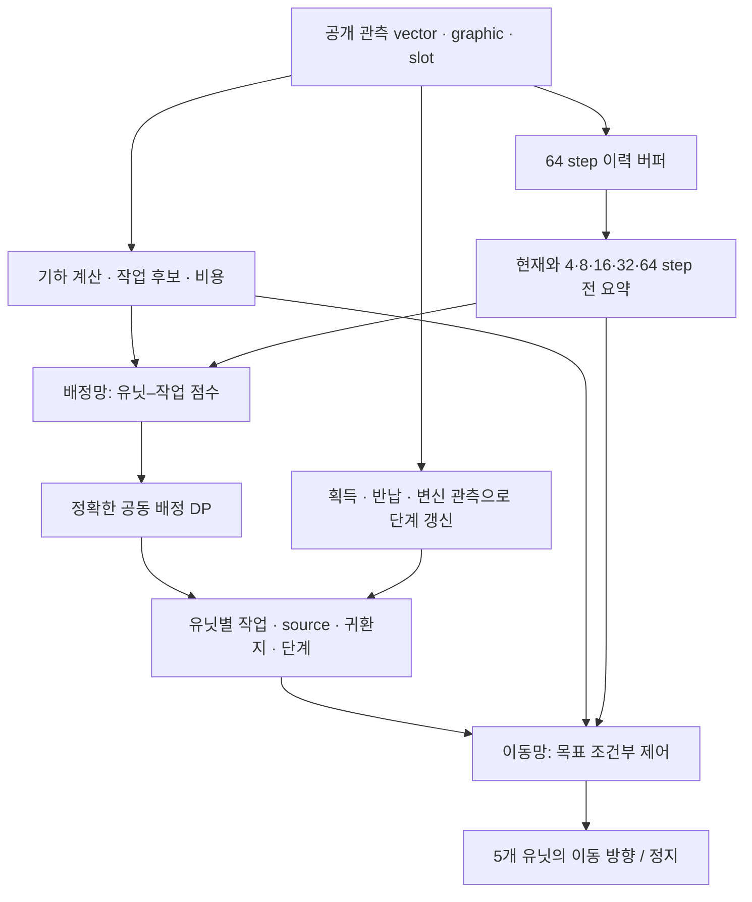

# v13 설계: 계산된 비용으로 배정하고, 목표를 조건으로 이동한다

작성일: 2026-11-02. 설계 제안이며 아래 차원·주기·예산은 초기 실험값이다. 실제 성능·지연시간을 측정한 값이 아니다. [근거와 해석](../reports/design_evidence.md), [구현·검증 계획](v13_implementation_plan.md)을 함께 본다.

2026-11-03: [실행 가능한 구현](../README.md)을 추가했다. 원 설계와 실제 후보 구성·B1 제어·진단 범위의 차이는 [구현 보고서](../reports/implementation.md)에 기록했다. 실험은 아직 시작하지 않았다.

## 1. 설계 결정

**서로 다른 두 actor를 둔다. 배정망은 팀의 작업 조합을, 이동망은 각 유닛의 실제 행동 방향을 선택한다.** 배정망은 v12의 거리·왕복 비용 기반 구조를 유지한다. 이동망은 계산된 경로 정보를 입력받되 경로 추종·회피·정지 중 무엇을 실행할지 직접 학습한다.

| 구분 | 배정망 Manager | 이동망 Worker |
|---|---|---|
| 질문 | 어느 유닛이 어떤 왕복 작업을 맡으면 유리한가? | 이 작업을 수행하려면 지금 어떻게 움직일까? |
| 결정 단위 | 팀 5개 유닛의 공동 배정 | 유닛별 방향 또는 정지 |
| 주기 | 기본 25 환경 step + 작업 무효화/완료 event | 관측이 들어오는 매 환경 step |
| 주 입력 | 유닛–작업 비용, 왕복 ETA, 대안, 팀 상황, 시간 기억 | 목표·단계, 국소 지도, 경로 거리장, 주변 움직임, 시간 기억 |
| 파라미터 | 유닛–작업 간 공유 MLP, 팀 전체가 사용 | 클래스 조건부 공유 신경망, 아군 5명이 사용 |
| 출력 | edge 점수 → capacity-constrained 공동 배정 | 32방향 + STOP의 확률 → `(dx,dy)` |
| 학습 | event PPO, 배정 전체의 log-prob | sequence PPO, 실행한 primitive action의 log-prob |

‘두 신경망’은 유닛마다 독립적인 망 10개를 두거나 제출 파일을 두 개로 나눈다는 뜻이 아니다. 두 actor의 파라미터·optimizer는 분리하고 공개 관측의 결정론적 전처리와 명시적 이력 데이터만 공유한다. critic은 학습 전용이다.



v12의 성능은 이 분리 설계의 출발점이다. 이동 제어 학습은 **검증할 가설**이며, 더 큰 망이 반드시 개선된다는 전제는 두지 않는다. 느린 Manager와 빠른 Worker라는 일반 원리는 [FeUdal Networks](https://proceedings.mlr.press/v70/vezhnevets17a.html)와 관련되지만, 이 설계의 명시적 작업·공동 배정 DP는 프로젝트 고유 구성이다.

## 2. 입력·환경 계약

- 기준 게임/API는 새 리그의 `af4c5fa` / `bcd8aad`와 등록된 전체 해시다. [새 리그 기록](../../v12/reports/full_league_new_game.md)을 따른다.
- 입력은 공개 `vector float32[5,96]`, `graphic float32[5,11,96,96]`, `slot int64[5]`다. 팀 모드에서 자기 class는 각 행의 self-class를 연결한다. 상대 class·실제 배터리 stack 수량·숨은 충돌 상태는 입력에 추가하지 않는다.
- Team B는 `y=x` 대칭으로 정규화하고 행동을 역변환한다. 이미지의 상하 축과 좌표 축도 함께 처리한다. 180도 회전이 아니다.
- 24×24 semantic map은 공개 이미지에서 모델 내부에서 만든다. 지도 불일치·누락 행을 탐지하고, 유효 행을 선택한다. 무조건 slot 0의 그림만 사용하는 구현은 금지한다.
- Hunter 동시 최대 2명, Carrier 최대 1명은 실제 엔진 제약이다. 특정 역할을 반드시 만들거나 비율을 고정하는 전략 규칙은 넣지 않는다.
- nonzero action은 게임에서 방향으로 정규화된다. 작은 벡터는 감속이 아니므로 정지는 정확한 `[0,0]`으로 출력한다.
- 과거 결과와 일치시키기 위한 v12 baseline을 제외하면, 학습의 terminal outcome과 평가 승패는 **최종 팀 점수**로 정한다. raw reward 합이나 `infos.winner`를 대신 쓰지 않는다.

관측의 `time_left`는 정규화 값이다. 현 게임에서 경과 초는 `420 × (1 − time_left_norm)`이다. 프레임 수를 초로 바꿀 때 렌더링 FPS나 time_scale을 곱하지 않는다. 실제 관측 시계 차이를 기록한다.

## 3. 배정망: 계산은 제공하고 선택은 학습한다

### 3.1 작업 표현과 후보

기본 작업은 v12의 collect-trip, deliver, special-trip, intercept, defend, raid-trip, transform-Hunter, transform-Carrier, private hold와 명시적 evade다. 수집 작업은 `source 접근 → 획득 확인 → 지정 창고 귀환 → 반납 확인`까지다. 실제 관측으로 확인한 단계 전이는 결정론적 상태 갱신이며 새로운 확률적 배정으로 기록하지 않는다.

source 하나를 귀환지별로 복제해 중복 수집을 허용하지 않는다. source를 작업 ID로 유지하고 각 unit–task edge에 귀환지를 둔다. 초기 귀환지는 공개 지형의 최단 합법 거리로 정하고, 실패 이력은 feature로 제공한다. 창고 선택 자체를 학습하는 확장은 별도 실험이다. 이 선택 규칙의 한계는 명시하며, 숨은 재고나 성공 확률을 아는 것으로 취급하지 않는다.

처음에는 기존 24개 폭을 재현하고 v13 본 실험은 **최대 32개 작업**을 제안한다. 진행 작업·운반 중 반납 후보·private hold를 먼저 보존하고, 왕복 거리와 경합 기준으로 합친 후보를 안정적 ID로 정렬한다. 작은 용량은 계산 예산을 위한 제한이다. 후보 생성 규칙도 정책의 일부이므로 config에 동결하고 넓은 후보 집합 대비 누락률을 측정한다. 수동 우선순위의 영향은 24/32/전체 합법 후보 대조로 구분한다.

task capacity는 중복 추격을 제한하며 실제 창고 저장 용량을 안다는 뜻이 아니다. 실제 역할 수와 진행 변신 예약을 함께 센다. 이미 배정에 들어간 예약을 다시 빼지 않는다. hard mask에는 물리적 불가능·역할 상한·source 충돌을 사용하고, ‘위험해 보임’, ‘너무 오래 걸림’만으로 edge를 영구 차단하지 않는다.

### 3.2 비용과 feature

v12의 64차원 feature 묶음(유닛 12, 작업 12, 경로 16, 팀 16, 이력 8)을 출발점으로 삼되 **새 schema ID**를 사용한다. evade 추가에 따른 kind 표현과 각 인덱스 의미를 구현 전 확정한다. 모양이 같다고 v12 가중치의 의미가 같다고 보지 않는다.

| 정보 | 계산·사용 원칙 |
|---|---|
| 편도·귀환 거리 | 벽·보호 본진·class별 통과 조건·대각선 corner-cutting을 반영한 경로 거리 |
| 왕복 ETA | `d_go / v_eff + d_return / v_eff + T_service`; 물리 단위와 정규화 단위를 구분 |
| 운반 상태 | 획득 후에는 남은 귀환 비용을 사용하고 이미 쓴 편도 비용을 다시 부담시키지 않음 |
| 경합 | 다른 아군의 최선/차선 비용, 적의 공개 위치·변위로 추정한 ETA와 불확실성 |
| 전환 비용 | 기존 목표에서 얻은 진행, 새 목표까지 거리, 바뀐 귀환 경로를 feature로 제공 |
| 시간·점수 | 최종 점수차, 남은 시간, 20초 흡수 phase, 최근 점수 변화 |
| 실행 성능 | 실제 작업 소요 시간, 정체·배달 지연, ETA 오차의 인과적 이동 평균 |

`v_eff`는 이동 중 관측에서 보정한다. 정지 관측으로 0에 가까워지는 분모를 만들지 않으며, unknown·표본 수·유효 기간을 제공한다. 보정기의 계수는 rollout에서 고정한다. Worker가 바뀌면 완료시간 분포도 바뀌므로 배정망 재학습 때 다시 보정하되 같은 PPO update 안에서 후보·비용을 바꾸지 않는다.

초기 배정망은 다음을 제안한다.

```text
m_i^M = Manager 전용 temporal encoder(현재, t−4, t−8, t−16, t−32, t−64)  # 64차원
g = 대칭 pooling한 팀 요약                                                    # 32차원
s_ij = MLP( concat(edge_feature_ij[64], m_i^M[64], g[32]) )
MLP: 160 → 128 → 64 → 1
```

본 모델의 점수는 학습 출력이다. v12의 고정 prior는 teacher와 baseline 재현에만 사용한다. 새로운 temporal branch를 포함한 초기화는 teacher 배정 모방으로 수행한다. 서로 다른 feature schema에 기존 가중치를 그대로 꽂지 않는다.

### 3.3 공동 배정과 결정 주기

`π_M(A|s) ∝ exp(Σ_i s[i,A_i] / τ)`에서 유효한 전체 배정 A를 sample한다. 유닛 부분집합 32개를 사용하는 v12의 정확한 DP를 계승한다. 이는 주어진 후보·가산 점수·용량 제약 안에서 정확하며, 경로 교차나 협공의 전역 최적성을 보장하지 않는다. 서로 다른 유닛의 선택을 사후 greedy로 고친 뒤 독립 log-prob로 학습하지 않는다.

기본 25 환경 step마다 재평가하고 획득·반납·목표 소멸·변신·respawn 관측 등 작업 의미가 달라진 경우 즉시 재평가한다. 위협·정체 수치는 입력으로 주고, 가까운 적이라는 이유만으로 회피 작업이나 다른 목표를 강제하지 않는다. Worker는 그 사이에도 회피·추격 방향을 바꿀 수 있다. 작업 유지와 변경은 같은 후보 집합 안의 학습 선택이다.

주기 25는 v12와의 비교를 위한 시작값이다. 8/16/25 step을 dev에서 비교하며, 이 주기와 4/8/16/32/64의 **관측 이력 간격은 서로 다른 설정**이다.

## 4. 이동망: 작업을 수행하는 실제 행동을 학습한다

Worker의 입력은 현재 자신의 class·보유물·이전 행동, 배정된 작업 kind·source·destination·phase·목표 상대 좌표, 주변 유닛의 상대 위치/이동, 국소 지도와 거리장이다. 과거 목표와 현재 목표가 다르면 과거의 ‘목표 거리 감소’를 동일 작업의 진전으로 비교하지 않도록 goal ID/version도 제공한다.

초기 네트워크 구성은 다음과 같다.

1. 현재 위치 중심 9×9 crop에 semantic 11채널, 현재 목표 1채널, 목표 거리장 1채널을 넣는다. 바깥 영역은 벽으로 padding한다. 목표가 crop 밖에 있어도 상대 목표 좌표와 거리장은 남는다.
2. 작은 CNN `Conv(13,16,3,pad=1) → ReLU → Conv(16,32,3,stride=2,pad=1) → ReLU → Flatten → Linear(800,64)`로 지역 표현을 만든다.
3. 지역 표현, 현재 유닛·작업 feature, Worker 전용 64차원 시간 표현을 MLP로 합친다. 잠정 추가 모델은 `GRUCell(input=128, hidden=64)`를 둔다. GRU 없는 대조군은 동일 입력을 비슷한 파라미터 수의 MLP에 넣는다.
4. categorical head로 **32개 균등 각도 + STOP**을 출력한다. 학습에서는 sample, 제출에서는 동결한 decoder를 사용한다. 선택 방향은 단위벡터이며 연속 2차원 API와 호환된다.

32방향은 연속 제어의 근사다. 16/32방향과 teacher 방향 양자화만 한 기준선을 먼저 비교해 양자화 손실을 분리한다. 필요하면 연속 각도 분포를 별도 arm으로 검증하되, 정규화 전 Gaussian 벡터와 실제 실행 방향의 확률을 혼동하지 않는다.

경로 계산기는 목표까지의 거리·권장 waypoint를 제공한다. **본 Worker의 출력을 근접 회피나 planner 방향으로 덮어쓰지 않는다.** teacher 모방과 planner-only baseline은 별도 모델이다. 벽·경계 등 확실한 물리 제약에 action mask를 사용한다면 학습/추론에서 같은 mask를 쓰고 sampling 전에 적용한다. 추정된 적 위험은 hard mask가 아니다.

긴 경로는 계산된 거리장이 안내하므로 국소 CNN이 미로 전체를 외울 필요가 줄어든다. 반면 물리 위치 오차·좁은 통로·추격 상대의 이동은 Worker가 처리한다. planner가 잘못된 경로를 주는 경우도 존재하므로 경로 없음/거리 stale flag와 STOP을 항상 유효하게 제공한다.

## 5. ‘RNN용 state에 4·8·16·32·64프레임 전을 넣는다’의 적용

### 5.1 용어와 채택안

가장 유력한 해석은 **서버가 다음 호출에 돌려주는 state tensor를 과거 관측 저장 공간으로 사용하고, 지수 간격의 시점을 읽는다**는 것이다. 여기에 GRU/LSTM을 붙일 수도 있지만 필수는 아니다. 과거 hidden state를 건너뛰어 연결하는 [DilatedRNN](https://arxiv.org/abs/1710.02224)은 별도 구조이며 발언만으로 그 사용을 단정할 수 없다.

v13의 기본 기억은 관측 요약 버퍼와 고정 lag read다. 우선 기억만 추가한 MLP와 기억+GRU를 비교한다. full DilatedRNN은 처음부터 추가하지 않는다.

### 5.2 정확한 이력 저장

여기서 frame은 **정상적으로 관측하고 처리한 policy/environment step**을 뜻한다. Unity 렌더링 프레임이나 25 step마다 발생하는 배정 event가 아니다. 각 token에 실제 게임 시각도 저장한다.

```text
호출 t 직전: H[k] = q_(t−1−k), k=0..63   # 최신 과거가 index 0
이번 입력:    q_t
읽기:         q_t, H[3], H[7], H[15], H[31], H[63]
다음 상태:    concat(q_t[None], H[:63])
```

따라서 **최근 64개 요약을 저장**해야 정확히 t−64를 읽을 수 있다. 다섯 개의 과거 값만 들고 매 step 갱신하면 다음 step에 필요한 중간 관측이 없어 일반적으로 정확한 lag를 유지할 수 없다. 64칸 shift register를 먼저 구현하고 동일 의미의 ring buffer는 최적화 단계에서 비교한다.

처음에는 최신 관측으로 과거를 채운 척하지 않고 zero padding + valid mask를 쓴다. 같은 좌표의 정규화 기준을 episode 내내 유지한다. lag 4 이상만으로 놓치는 짧은 접촉/회피는 현재 정보와 이전 행동, 선택적 GRU로 보완하고 `{0,1,2,4,8,16,32,64}`를 추가 대조한다.

### 5.3 무엇을 저장하는가

원본 이미지 64장을 저장하지 않는다. 첫 버전은 유닛별 **학습 가중치에 의존하지 않는 128차원 token**을 저장한다. 초안 배치는 다음과 같으며 구현 시 인덱스·단위·unknown을 schema 파일로 동결한다.

| 항목 | 차원 |
|---|---:|
| 팀 좌표 정규화 후 해당 행의 공개 vector | 96 |
| 직전 실행 행동 / 직전 목표 좌표 | 2 + 2 |
| 직전 task kind 10종 / phase 4종 | 10 + 4 |
| 작업 나이, 목표 경로 거리, 직전 진전, respawn proxy | 4 |
| 실제 게임 시각, 유닛 이력 segment, goal version, valid | 4 |
| 확장용 0 padding | 6 |
| 합계 | **128** |

q_t는 배정 전 시점에 구성하고 직전 목표 문맥을 담는다. 현재 새 배정은 Worker에 별도로 전달한다. 이렇게 해서 현재 행동/새 배정이 자기 선택의 입력 이력에 먼저 들어가는 순환과 미래 정보 누출을 막는다. respawn proxy는 관측상 추정이며 숨은 사망 flag라고 부르지 않는다. 목표 거리의 스케일·unreachable 표현을 고정한다.

각 lag token에 상대 lag와 실제 age를 붙여 공유 MLP로 32차원 인코딩하고, 오래된 순서가 고정된 여섯 표현을 concat해 64차원으로 만든다. Manager와 Worker는 이 raw buffer를 공유하지만 각자의 encoder를 학습한다. 이동 차이는 `(위치_t − 위치_past) / 실제 경과 시간`으로 계산하며 teleport/respawn 추정 구간은 mask한다.

학습된 embedding만 캐시하면 encoder 갱신 전후 표현이 섞인다. raw feature 저장을 기본으로 하여 update 때 같은 원본을 새 encoder로 다시 계산한다. 과거 graphic은 버퍼에 없으므로 **과거 지형·아이템 지도 전체를 기억하는 모델은 아니다.** 필요성이 드러나면 고정 지도 요약을 확장 실험으로 추가한다.

### 5.4 장점·한계와 시간 누락

가까운 과거는 속도·방향·충돌, 먼 과거는 왕복 진전·정체·상대의 접근 추세를 파악하는 데 도움이 될 수 있다. 다만 이 입력이 장기 신용 할당을 해결하거나 64 step보다 긴 전략 기억을 보장하지는 않는다. 20초 흡수 phase는 현재 게임 시각에서 직접 계산한다.

서버 timeout이면 행동이 0으로 대체되고 상태가 갱신되지 않을 수 있다. 누락 slot도 자기 state를 유지한다. 이 경우 버퍼 index는 정확한 실제 환경 step lag가 아니라 **마지막 성공 호출 기준 lag**가 된다. 시간 stamp로 gap을 알리고, 큰 gap 뒤에는 GRU를 reset하며 이전 이력의 연속 속도 추정을 무효화한다. 관측하지 못한 프레임을 만들어 넣지 않는다. 정상 연속 호출의 정확한 lag와 오류 복구의 근사 의미를 구분한다.

## 6. 명시 상태와 ONNX 제출

공식 `state_in* → state_out*`는 데이터를 보관하는 포트다. 그 안에 GRU hidden뿐 아니라 이력·목표·경로 캐시를 넣을 수 있다. [최신 계약](../../common/environment_update_2026-11-01.md)과 실제 `onnx_policy.py`에서 `(B,...)` float32, B 뒤 고정 크기, suffix 대응을 확인했다.

| 포트 초안 | shape | 의미 |
|---|---|---|
| `state_in_history` / `state_out_history` | `[5,64,128]` | raw token과 각 시점 valid/time/segment |
| `state_in_worker` / `state_out_worker` | `[5,64]` | GRU arm에서만 사용하는 hidden |
| `state_in_task` / `state_out_task` | `[5,D_task]` | task의 의미 ID, source/destination, phase, version, 나이, 마지막 update 시각 |
| `state_in_nav` / `state_out_nav` | `[5,D_nav]` | 필요한 거리장·walk mask·cache key; export spike에서 고정 폭 확정 |

history만 **163,840 bytes = 160 KiB/팀**, GRU hidden은 1,280 bytes = 1.25 KiB다. state input/output을 모두 전송하면 이 부분만 호출당 322.5 KiB이며, 다른 상태·현재 graphic·프로토콜 오버헤드는 별도다. 영상 64프레임은 `5×64×11×96×96×4 = 129,761,280 bytes`로 약 123.75 MiB이므로 같은 비용이 아니다.

`meta.json`은 초기에는 `{"mode":"team","frame_stack":1}`이다. 내장 frame_stack은 최대 16개의 **연속** 관측이므로 `frame_stack=64` 또는 lag 목록을 지정하는 것으로 해결할 수 없다. 최종 graph 첫 일반 출력은 `action float32[5,2]`이며 나머지는 대응하는 `state_out*`다. 훈련용 critic/logit을 action보다 앞에 export하지 않는다.

slot별 task/state를 사용하고 팀 배정은 매 event 현재 행들을 모아 재계산한다. 누락 행은 새 task를 받을 수 없고, 그 slot의 기존 예약은 유효성을 확인할 때까지 보수적으로 용량에 반영한다. 돌아온 행은 timestamp가 오래됐으면 즉시 task 유효성 검사 후 재배정한다. 팀 전체 상태를 slot 0에만 넣어 slot 0 누락 때 모두 잃는 설계는 피한다.

episode 시작·진영 변경은 전체 reset이다. 개별 respawn 추정은 해당 유닛 Worker hidden과 task를 초기화하고 segment를 바꾼다. 다른 유닛의 팀 상황 이력까지 지울 필요는 없다. 변신은 class/phase를 갱신하며 무조건 episode reset으로 취급하지 않는다. 서버 재시작은 상태가 사라지는 조건으로 검증한다.

### 6.1 경로 계산도 제출 graph의 일부다

v12 ONNX는 scorer+MAP DP만 포함하며 Python이 후보 생성·FSM·Dijkstra를 수행한다. 두 신경망만 export해도 공식 제출물이 되는 것은 아니다. **관측 decode → 후보/비용 → DP → task 상태 → 거리장 → Worker → 상태 갱신**을 모두 graph와 허용 state 안에 넣어야 한다.

첫 단계에서 다음 경로의 작은 export prototype을 만든다.

- CPU reference는 기존 8-neighbour Dijkstra를 사용한다. 단위 축 이동 비용 1, 대각선 √2, corner-cutting 금지를 유지한다.
- ONNX reference는 24×24 grid의 min-plus relaxation으로 동일 거리를 계산한다. 양수 edge와 576개 정점에서 최단 단순 경로는 최대 575 edge이므로 최악 조건을 다룬다. 작은 반복 수를 썼다면 exact distance가 아닌 근사로 표기한다.
- 비용에는 유닛 위치/창고에서 시작한 여러 field를 묶고, Worker용 field는 선택된 목표에 대해서 계산한다. 지도·class·통과 조건·목표가 같을 때만 cache를 재사용한다. 이전 빌드의 고정 맵 경로를 재사용하지 않는다.
- ONNX 제어 흐름으로 event/캐시 miss에서만 비싼 계산을 수행하는 경로를 검증한다. `Where`로 결과만 고르면 양쪽 계산이 실행될 수 있으므로 계산을 생략했다고 주장하지 않는다.
- 후보 추출·창고 component 정리도 tensor 연산으로 포함하고 capacity/ID를 reference와 비교한다. 파이썬 heap이나 dict가 배포 시 존재한다고 가정하지 않는다.

575회 격자 갱신은 작은 MLP보다 훨씬 비쌀 수 있다. 공식 100ms는 전송을 포함한 팀 전체 한도다. 캐시 miss·재배정이 집중된 p99/최대 지연을 먼저 측정한다. 통과하지 못하면 tensor 경로 최적화 또는 검증된 거리 근사로 설계를 다시 동결하고 **학습 입력도 같은 방식으로 변경**한다. 이를 해결하기 전에 대규모 학습을 시작하지 않는다. Windows Python 실행 성능을 공식 컨테이너 통과 증거로 삼지 않는다.

## 7. 학습: 두 수준의 결정과 보상을 일치시킨다

### 7.1 단계별 최적화

1. **teacher 데이터:** 고정 `v12-before-learned`를 새 빌드에서 실행하여 공개 관측, 내부 task, 실행 행동, 실제 작업 결과를 새로 수집한다. 기존 리그 trace는 매 step 전체 graphic/task를 보장하지 않아 완전한 지도 학습 데이터로 취급하지 않는다.
2. **모방 초기화:** Manager는 teacher의 전체 배정 negative log-likelihood, Worker는 실행 방향을 양자화한 categorical cross-entropy로 학습한다. teacher를 정답 oracle로 취급하지 않는다.
3. **이동망 학습:** Manager를 동결하고 Worker만 PPO로 학습한다. 쉬운 귀환/통로 사례에서 시작하되 실제 게임 관측과 물리를 사용한다. teacher의 안전한 상태뿐 아니라 Worker가 방문한 실패 상태에도 teacher label을 받을 수 있게 한다.
4. **배정망 적응:** 검증된 Worker를 동결하고 실제 소요 시간으로 비용 통계를 보정한 뒤 Manager를 PPO로 학습한다.
5. **교대 미세조정:** 한 수집·update 구간에는 한쪽 actor만 갱신한다. 다른 쪽 가중치·feature 보정기·decoder를 고정하고 다음 단계에는 새 rollout을 수집한다. 완전 동시 joint update는 후순위 실험이다.

teacher 모방 강도는 dev에서 줄여 나가며 영구적인 행동 강제가 되지 않게 한다. class별 독립 망을 먼저 만들기보다 class 조건부 공유 Worker를 시작점으로 한다.

### 7.2 보상과 return

기본 terminal reward는 최종 점수 승/무/패의 `+1/0/−1`이다. episodic 목적을 유지하는 초기값으로 `γ=1`을 사용한다. 학습 보조는 공개 점수차의 bounded potential `Φ`에 대한 `β(γΦ(s_next)−Φ(s))`를 제안하며 terminal에서는 `Φ=0`으로 둔다. shaping 전후 결과를 모두 기록한다. raw 게임 보상은 분석용으로 별도 저장한다.

Worker가 목표에 가까워지기만 하고 반납을 못 하는 정책을 피하기 위해, 본 경기의 기본 joint objective에는 거리 감소·헌터 수·kill 횟수 보너스를 추가하지 않는다. 목표 거리 shaping은 필요할 경우 Worker 사전학습 arm에만 사용하고 task 변경/종료의 potential 경계를 처리한다. task를 자주 바꿔 보상을 다시 얻는 경로를 허용하지 않는다.

Manager event 간 실제 길이를 Δ라 할 때:

```text
R_event = Σ_(k=0..Δ−1) γ^k r_(t+k)
δ_event = R_event + γ^Δ V_M(s_(t+Δ)) − V_M(s_t)
GAE event trace multiplier = (γ λ)^Δ
```

Worker는 매 환경 step의 return을 사용한다. λ 초기 제안은 .9995이며 실제 시간 스케일·advantage 분산을 확인한다. 환경의 자연 종료는 bootstrap=0, 수집 chunk 경계는 value로 bootstrap한다. 환경 watchdog 실패를 자연 패배로 기록하거나 미완료 episode에 임의 terminal reward를 붙이지 않는다.

### 7.3 PPO 기록과 sequence replay

Manager는 후보 ID/목적지/feature/mask/capacity/온도/전체 배정/old log-prob/event 길이를 저장한다. 과거 후보를 현재 모델로 다시 생성하지 않는다. Worker는 이력 원본, 배정 문맥, primitive action index, action mask, old log-prob와 hidden 시작값을 저장한다.

Worker의 정책을 조건부 독립 출력으로 두면 팀 primitive action의 log-prob는 **5개 유닛 log-prob의 합**이다. 기본 PPO는 이 joint ratio를 사용하고 팀 reward에 대한 팀 critic으로 advantage를 계산한다. 유닛별 clip을 평균하는 실험은 다른 surrogate이며 동일 알고리즘으로 부르지 않는다. Manager와 Worker의 서로 다른 길이 log-prob를 한 ratio에 섞지 않는다.

초기 recurrent 학습 단위는 **burn-in 64 step + loss unroll 128 step**이다. history 64칸은 메모리 입력의 범위, burn-in은 hidden 재구성, unroll은 gradient 범위이므로 같은 개념이 아니다. 시작 history snapshot 또는 추가 prefix가 필요하다. burn-in 앞에서도 과거 64칸이 유효하도록 checkpointed raw history를 함께 저장한다.

burn-in 중 loss를 계산하지 않고 현 파라미터로 hidden을 재구성한다. loss 구간에서 TBPTT를 수행하고 episode/respawn/gap mask를 재생한다. chunk 시작에 저장한 hidden의 stale 영향은 남을 수 있으며 burn-in이 이를 완전히 제거한다고 주장하지 않는다. frozen 파라미터 재생에서 수집 당시 상태·행동·log-prob와 일치하고 ratio=1인지 먼저 검사한다. recurrent state staleness는 [R2D2 연구](https://willdabney.com/publication/r2d2/)에서도 다룬 문제이며, 여기서는 그 문제의식을 PPO sequence 설계에 적용한다. R2D2 알고리즘 자체를 채택한 것은 아니다.

## 8. 실행·채택 원칙

경기가 끝나면 해당 worker slot에 다음 경기를 바로 배정한다. 다른 경기 전체 종료를 기다리는 wave가 기본 단위가 아니다. PPO 수집은 고정 길이 chunk와 동결 actor 버전으로 관리하며, learner update 경계 대기와 경기 배정 대기를 구분한다. 자세한 버전 전환·평가·예산은 [구현 계획](v13_implementation_plan.md)을 따른다.

채택에는 새 seed·진영 교대에서 v12 직접 대결과 기존 상대군 평가가 모두 필요하다. 특히 weak/default/special 및 v4~v7 상위권을 따로 본다. 이동망 추가, 지수 간격 기억, GRU 효과를 분리해서 검증한다. 성능이 비슷하면 더 단순하고 빠른 모델을 선택하며, 기억이나 GRU는 이름 때문에 유지하지 않는다.
